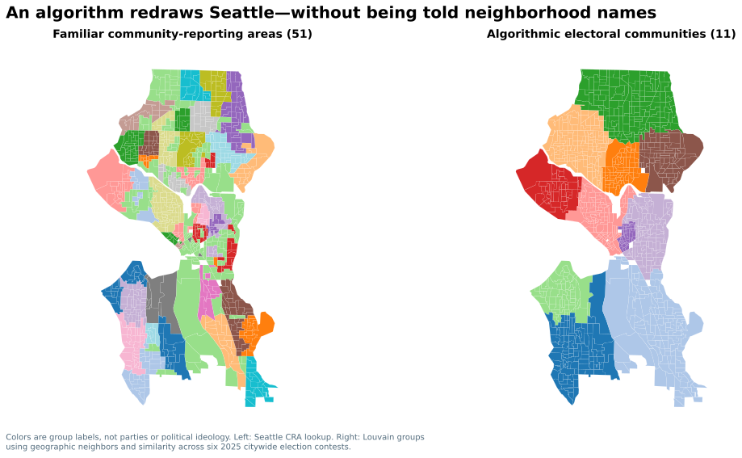

# Seattle, Through the Numbers
### Eight Computational Experiments on the 2025 Election

**What else can we learn from an election decided by just 2,011 votes?**

Seattle narrowly elected Katie Wilson as mayor, but the bigger story isn't visible on a normal winner map. Even in precincts won by Bruce Harrell, other candidates and both city propositions won majority support. Two neighborhoods that looked politically similar before November sometimes separated sharply. And what happens when we ask an algorithm—not a city planner—to divide Seattle into political neighborhoods?

This independent research note examines **eight questions with eight graphics**: voting coalitions, unequal participation, prediction uncertainty, political twins, campaign funding, the limits of precinct-level inference, newly discovered electoral communities, and whether those communities survive scrutiny.

### **[Read the illustrated research report](reports/seattle_through_the_numbers.md)**

You don't need to know Python to follow the argument. Each experiment explains the statistical trick in plain language; its source code and source data are available for anyone who wants to inspect the method.

[Explore the earlier mayoral research](reports/00_beyond_the_election_map.md) · [View the computational source](scripts/) · [Research inspiration library](docs/visual-research-inspiration.md)

*Independent, nonpartisan, exploratory analysis. The report is currently under editorial review. Statistical comparisons describe precinct-level patterns, not individual voters' decisions or their causes.*
