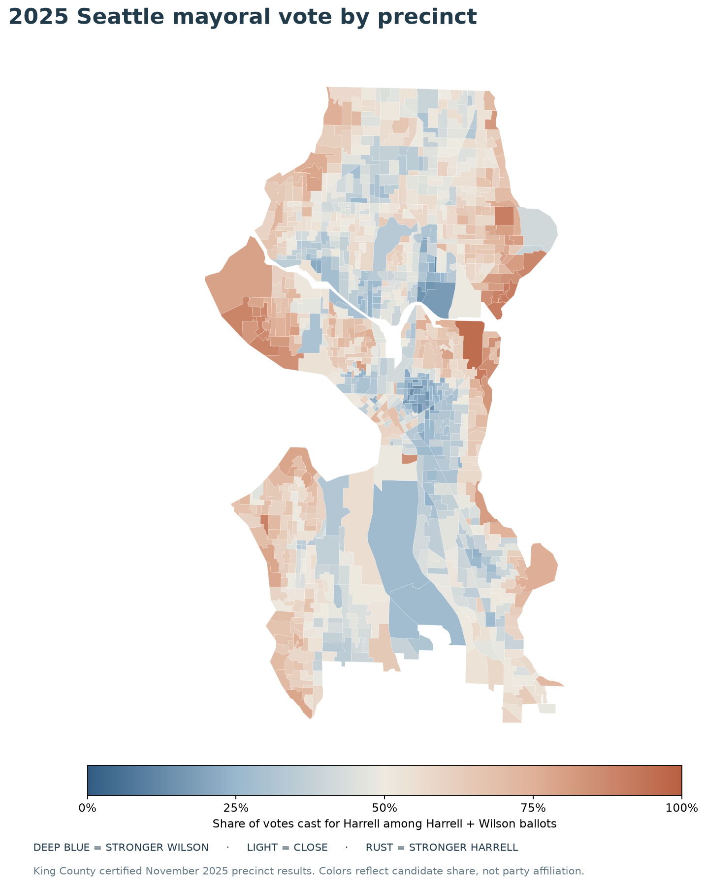

# Seattle, Precinct by Precinct
### Where Seattle's voting lines came from—and what the 2025 mayoral election tells us

Seattle's 2025 mayoral race was decided by 2,011 votes. How did those votes break down across more than a thousand precincts? What is a precinct, who draws its boundary, and how much can neighbors differ politically?

**[Read the illustrated precinct field guide](reports/seattle_precinct_by_precinct.md)**

The guide covers the history and growth of Seattle precincts, their geographic size and registered voters, the 2025 election, changes in Harrell's support since 2021, sharp voting contrasts across adjoining precincts, and an exploratory grouping of precincts using network analysis.

The charts include a geographic precinct map alongside a vote-weighted circle map. Historical comparisons use only verified same-boundary precincts.

### Research and code

- [Main analysis code](scripts/precinct_field_guide.py) and [additional analysis](scripts/precinct_field_guide_extensions.py)
- [Earlier eight-experiment report](reports/seattle_through_the_numbers.md)
- [Source data and caveats](reports/seattle_precinct_by_precinct.md#sources-and-notes)

*Independent exploratory research using public King County election returns and voting-district geography. Second draft for editorial review.*
