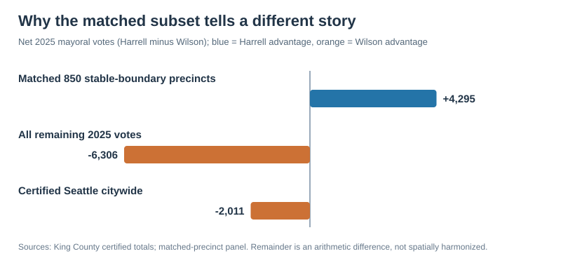

# Methodology: Precinct coverage and boundary comparability

## Coverage check (internal quality control)

Our **850 unchanged-boundary precincts cover 82.3% of Seattle's two-candidate mayoral votes** in 2025, but they do not reproduce the citywide result. Within those precincts, Harrell led by **4,295** votes. Among all votes outside the matched subset, Wilson led by **6,306** votes. Citywide, Wilson won by **2,011** votes.

| Vote universe | Harrell | Wilson | Net Harrell votes |
|---|---:|---:|---:|
| 850 stable-boundary precincts | 115,637 | 111,342 | +4,295 |
| All remaining Seattle votes | 21,283 | 27,589 | −6,306 |
| Seattle citywide (certified) | 136,920 | 138,931 | −2,011 |

**What this means:** The unchanged-boundary panel is a deliberately selected subset, not a representative sample of the city. Drawing citywide conclusions using only the 850 would be misleading. These counts do **not** tell us why voters made their choices.

The repository's 2025 Census crosswalk contains 1,019 unique precinct IDs, of which 169 do not appear in the 850-row matched panel. The 'remaining votes' line above is calculated as **certified citywide votes minus votes in the matched panel**; we have not yet independently rebuilt the votes for each excluded precinct.

## Can the full 2021–2025 comparison be recovered?

King County publishes final precinct election results for both years and archived precinct boundaries. Since precinct boundaries were changed after 2021, the correct next step is to construct a 2021-to-2025 spatial overlap crosswalk and estimate how 2021 results would look within 2025 precinct geography.

We should clearly distinguish:
- **Direct comparisons:** precincts with effectively unchanged boundaries.
- **Harmonized estimates:** changed boundaries reallocated using geographic overlap, ideally refined using Census-block voting-age population.
- **Citywide totals:** use certified election figures as the source of truth.

We should compare the directly matched subset and the expanded estimate as a sensitivity check. Geographic allocation is not direct evidence of how individual voters voted or switched candidates, and Harrell faced different opponents in 2021 and 2025.

## Reproduce the internal verification figure

Run the script from the project folder. No dependencies beyond the Python standard library are necessary:

    python scripts/coverage_audit.py

The script validates duplicate IDs, stable-boundary labels, candidate-vote sums, and whether matched precincts appear in the Census crosswalk. It then regenerates the SVG figure and prints the coverage audit.

## Sources

- [King County: 2025 certified mayoral result](https://kingcounty.gov/en/dept/elections/results/2025/november-general)
- [King County: 2025 final precinct results](https://data.kingcounty.gov/d/rkie-6y8x)
- [King County: 2021 final precinct results](https://data.kingcounty.gov/d/4qrf-rjar)
- [King County: legacy precinct boundaries](https://kingcounty.gov/en/dept/elections/maps/precinct-and-district-data)
- Repository data: `data/processed/seattle_mayor_precinct_panel_2021_2025.csv` and `data/processed/block_group_to_2025_precinct_crosswalk.csv`

This is a **methodology appendix, not a headline finding**. The next milestone is a documented geographic crosswalk, followed by Precinct Twins, Political Fault Lines, and spatial outlier analysis.
