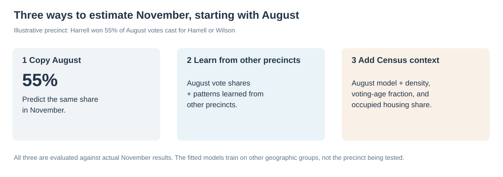
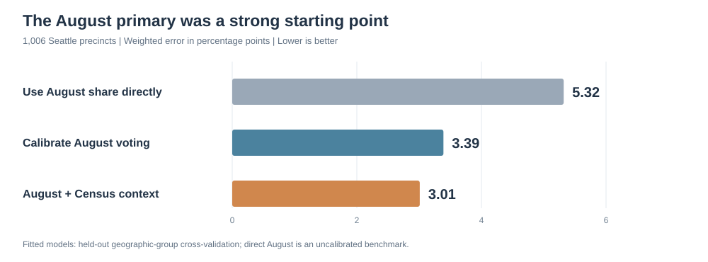
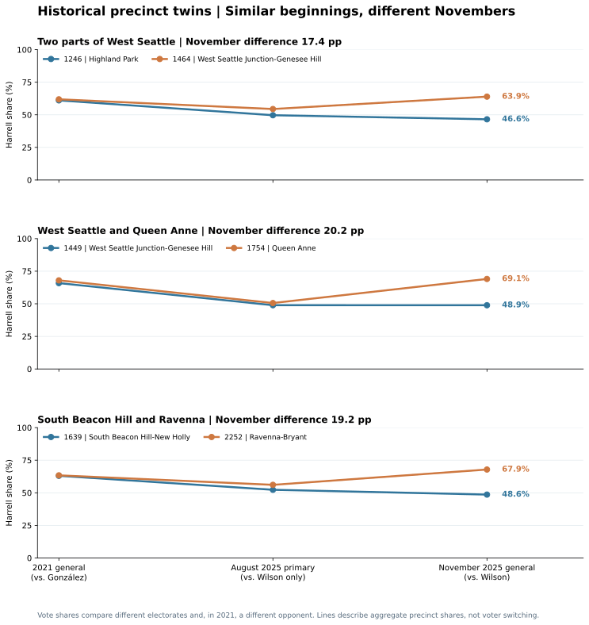
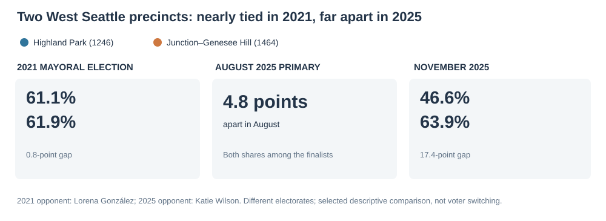

# Seattle's 2025 election: three ways to see what a map misses

*An illustrated investigation using machine learning, geographic networks, and the surprisingly revealing idea of political twins.*

**Seattle election research · November 2026 · Revised draft for review**

Katie Wilson defeated Bruce Harrell by **2,011 votes**, 138,931 to 136,920. A normal precinct map can tell us where each candidate was strongest. But it cannot answer three more interesting questions: **How much of November could we have anticipated? Where did apparently similar places split? And how sharply can politics change across a single street?**

To investigate, I combined official King County precinct results, Seattle voting-district boundaries, and selected 2020 Census measures. The techniques are common in machine learning and geographic data science; applying them together to this election creates a different view of the city.

## 1. Could August have told us what November would look like?

Imagine a precinct where Harrell won **55% of the August votes cast for Harrell or Wilson**. The simplest November estimate is 55%. But the primary also included other candidates, and the electorate and voting patterns changed by November. Can a computer learn a better estimate from the rest of Seattle?

**The trick: train on some precincts, test on others.** Using Python's **scikit-learn**, I trained a statistical model to learn how August precinct voting related to November results. Then I tested it on *different geographic groups of precincts* whose November results were hidden from the model during training. I repeated this five times so every eligible precinct was tested.

This is **retrospective prediction**, not an Election Day forecast: the model learns from November results in *other* precincts. The question is how well that relationship generalizes to places the model has not seen.

**How to read these bars:** Each number is the average distance between a precinct's estimated Harrell vote share and his actual November share, weighted by November votes. **A 3-point error means a prediction of 50% when the result is 53%, or 47%. Smaller bars are better.**

- **5.32 percentage points:** Simply reuse each precinct's August Harrell share among the two finalists.
- **3.39 points:** Let a fitted model learn from August voting patterns, including the share that went to other primary candidates.
- **3.01 points:** Give that model three additional Census clues: population density, share of residents old enough to vote, and the fraction of housing units occupied. **Occupancy does not mean homeownership.**

The added Census clues improved the fitted August model's error by about **11%**, from 3.39 to 3.01 points. But the bigger story is that **August already contained a great deal of information about November's geography**. A strong prediction is not an explanation of why individual people voted as they did.

*Tool worth knowing: **Ridge regression** is a form of regression that limits extreme model coefficients. **Geographic cross-validation** is the more important idea here: test on places the model did not train on, rather than grading it on its homework.*

## 2. What if two places looked alike—until November?

A citywide prediction score can hide its most interesting exceptions. Instead of drawing a cloud of 1,006 dots, let's ask a more human question: **Can we find two Seattle precincts that looked similar *before* the general election but ended up voting very differently?**

That is a **nearest-neighbor search**, an algorithm also used in recommendation systems and similarity search. Here, each precinct is represented by a small collection of numbers. Python compares those profiles and looks for close matches.

To make the comparison meaningful, I required similar **2021 Harrell vote shares**, similar **August 2025 voting**, and similar broad Census characteristics. The 2021-to-2025 geographic boundaries also had to be sufficiently stable. **November's outcome was deliberately left out of the matching step.** Only afterward did I rank pairs by how far apart they finished.

### A West Seattle puzzle

Consider **Highland Park (precinct 1246)** and **West Seattle Junction–Genesee Hill (precinct 1464)**. They were not identical neighborhoods, but they passed our pre-November similarity rules.

In the **2021 mayoral election**, Harrell received **61.1%** and **61.9%** of the two-candidate vote in these precincts—a difference of less than one percentage point. In the **August 2025 primary**, their Harrell-versus-Wilson shares were only **4.8 points apart**.

Then came November: **46.6% in Highland Park versus 63.9% in Junction–Genesee Hill**, a gap of **17.4 percentage points**. These were selected *because* their November results diverged, not because the algorithm predicted this split in advance.

What might explain it? November turnout also differed: **62.4% versus 76.6%**. That is a clue, not proof. The data cannot tell us whether different residents voted, some residents changed their preferences, or other neighborhood characteristics mattered. The Census features used here do **not** include income, education, or owner-versus-renter status.

This is why matching is useful: it does not magically establish causation. It **helps us ask a sharper question** than “Which neighborhoods voted differently?”

Across **846** eligible precincts with validated 2021 histories, **1,775 potential pairs** passed the matching rules. Two more striking examples appear in the chart above: West Seattle versus Queen Anne (**20.2-point November gap**) and South Beacon Hill–New Holly versus Ravenna–Bryant (**19.2 points**).

*Tool worth knowing: **scikit-learn's NearestNeighbors** compares numerical profiles. The result is only as good as the variables used to define “similar.” Here we also set maximum allowed differences on individual characteristics, rather than accepting every algorithmic match.*

## 3. Can two precincts share a border but live in different political worlds?

The twins were deliberately separated geographically. Now reverse the question: **What if two precincts are literally next door?**

Using **Shapely**, a Python geometry library, I treated precincts as a network. Each precinct is a node; a connection exists when two precinct shapes share at least **100 feet of border**. I then compared Harrell's vote share across every qualifying connection.

Of **2,582** eligible neighboring pairs, one striking contrast is in **Queen Anne**: precincts **1709 and 1724** share about **1,283 feet of boundary**, yet Harrell received **23.8%** of the two-candidate vote in one and **81.4%** in the other. That's a **57.6-percentage-point difference**.

That does not necessarily mean the border is mysterious. A Seattle resident might recognize sharp changes in housing, land use, or population from one side of a neighborhood to another. The algorithm identifies *where to look*; the next job is to explain the contrast with grounded local evidence.

*Tool worth knowing: **Shapely** computes whether two geographic shapes actually share a line, rather than merely looking close on a map. The same building block is useful in real estate, transportation, zoning, and environmental analysis.*

### One last reality check: are the unexpected results themselves clustered?

A **Moran-style spatial test** asks whether neighboring precincts tend to make similar prediction errors. The citywide association was positive but small (**Moran's I = 0.100**; permutation p = 0.0001). Yet **none of the 1,006 individual precinct tests remained significant** after correcting for the many comparisons.

That is a useful negative finding: **we should not draw confident “surprise hotspots” just because a few colored precincts appear near each other.** This calculation used NumPy/SciPy and a tested custom implementation, not a completed PySAL installation.

## What these three techniques taught us

**Prediction** showed that August already explained much of the geographic pattern. **Similarity matching** surfaced places that started alike but finished far apart. **Spatial networks** pinpointed extreme divides between literal neighbors.

The most promising next investigation is the West Seattle twin: **would the comparison still look surprising after adding income, housing tenure, and education?** Those data are not part of this version. Rather than add a flashy algorithm without a question, I'd test that explanation next.

---

### Behind the analysis

The code is public, reproducible, and intentionally exploratory. The **2020 Census-to-precinct allocation** estimates how Census areas contribute to each voting precinct; the underlying boundaries don't match perfectly. This is often called a *crosswalk* in data engineering, but it is **not** a list of actual 2025 voters. Likewise, 2021 precincts required boundary checks before historical comparison.

**Read more:** [Plain-English and technical methods appendix](../docs/methodology/techniques_explained.md) · [What each processed dataset contains](../docs/data/processed_datasets_guide.md) · [Code and reproduction instructions](../README.md) · [Official King County November precinct results](https://data.kingcounty.gov/d/rkie-6y8x).

*Vote shares refer to Harrell's votes divided by votes for the two named finalists, not all ballots cast. The 2021 opponent was Lorena González, while 2025 comparisons use Katie Wilson. These are aggregate precinct comparisons, not evidence that individual voters switched candidates. The matching examples are selected extremes and should not be treated as a representative sample.*
