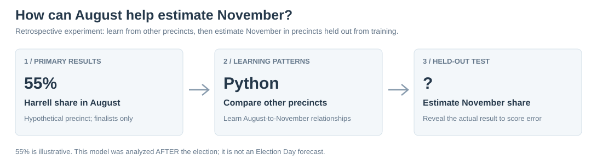
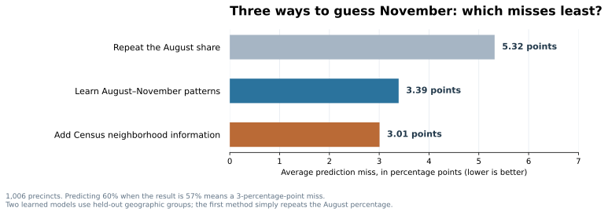
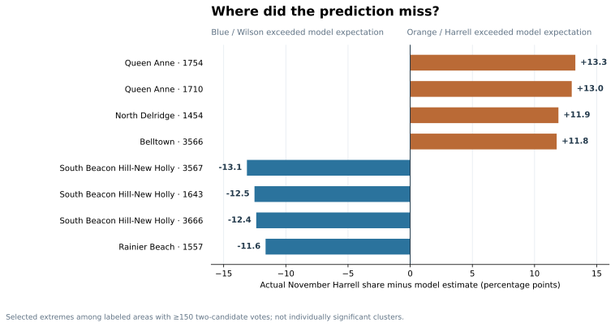
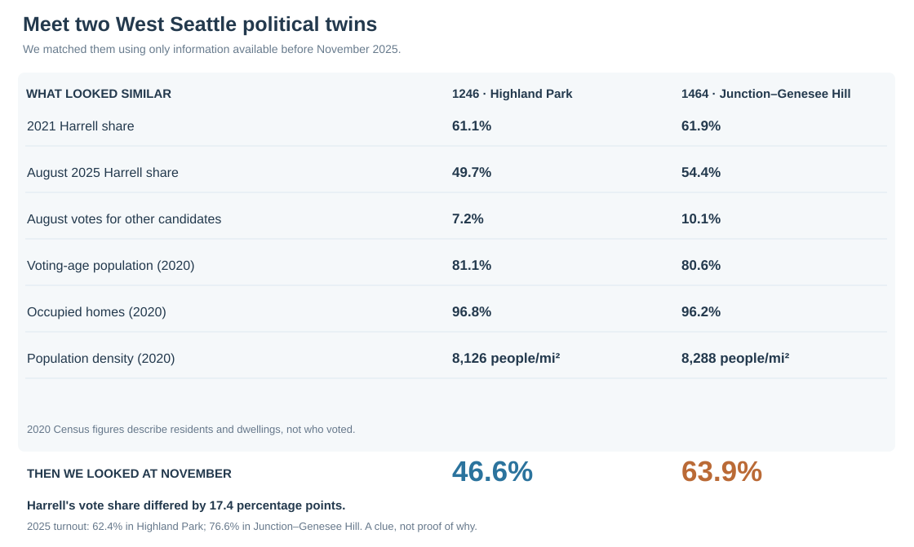
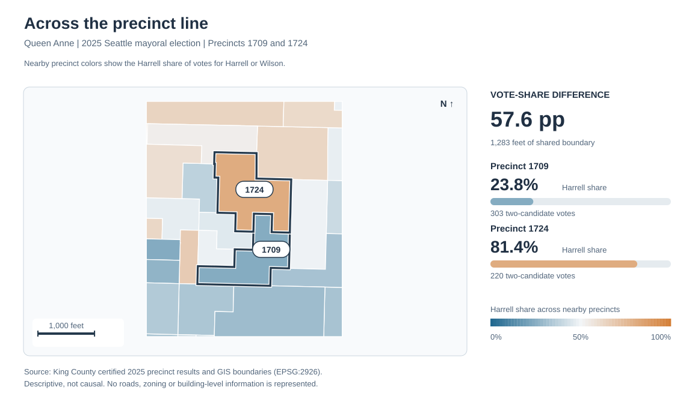

# Beyond the Election Map: Seattle's Political Lookalikes
*An illustrated investigation using machine learning, geographic networks and 2025 mayoral votes*

**SEATTLE · NOVEMBER 2026 · DATA RESEARCH**

Katie Wilson received **138,931** votes in Seattle's 2025 mayoral general election; Bruce Harrell received **136,920**. A normal election map tells us where each performed best. We tried something different: **could a computer first learn Seattle's familiar voting patterns, then find the places that defied them?**

Our most intriguing example is in West Seattle. Highland Park and Junction–Genesee Hill gave Harrell almost identical vote shares in **2021**. Their August **2025 primary** shares were also close. By November 2025, they were **17.4 percentage points apart**.

How did we find that pair among roughly a thousand precincts? Three approachable computational tricks.

*A quick translation:* a **precinct** is a small voting area. **Vote share** is the percentage of Harrell-or-Wilson votes received by Harrell. A **percentage-point difference** is subtraction: 60% minus 45% = **15 points**—not a 15% relative change.

---

## 1. Teach a computer Seattle's voting habits

**The trick — supervised learning, using scikit-learn.** Imagine a precinct where Harrell received 55% of the votes cast for him or Wilson in August. The simplest November estimate is **55% again**. But we can do better by teaching a model how August and November voting differed in *other precincts*.

We use **Ridge regression**: an algorithm that learns a relationship between input variables and an outcome while discouraging extreme coefficients. It learns from August vote shares—including support for other primary candidates—and, in an expanded version, three Census measurements: population density, voting-age population share and housing-unit occupancy.

This was **a retrospective experiment, not an Election Day forecast**. We used November results from some precincts to train the model, then tested it on geographically separate groups of precincts whose November results were hidden during training. Repeat that five times, until each group has been tested. This is called **geographically grouped cross-validation**.

**Read the bars as mistakes, not votes.** If the model predicts **60%** and a precinct actually votes **57%**, that is a **3-percentage-point error**. The graph averages the size of these misses across **1,006 precincts**, giving more weight to precincts with more votes.

| What the computer knew | Average miss |
|---|---:|
| Just repeat the precinct's August finalist share | **5.32 points** |
| Learn the August-to-November relationship from other precincts | **3.39 points** |
| Also use three Census characteristics | **3.01 points** |

**The insight:** Past voting did most of the predictive work. The Census variables improved accuracy by roughly **11% compared with the fitted August-only model**. That extra complexity helped, but didn't transform the story. The model estimates vote shares; it does not know *why* someone voted.

*Why this is useful beyond elections:* The same machine-learning idea helps analysts predict demand, detect unusual transactions and compare future outcomes with a baseline.

## 2. Instead of mapping winners, map the model's mistakes

Once we could estimate each precinct's November result, we asked: **where was the computer most wrong?**

**How to read it:** The center line means the model was exactly right. To the **right**, Harrell did better than expected. To the **left**, Wilson did better than expected. A bar stretching 12 points means the actual Harrell share differed from the predicted share by 12 percentage points.

These are **selected extreme errors**, not statistically confirmed anomalies. They are clues to examine, not diagnoses of the neighborhoods. A model may miss something because of turnout, housing patterns, candidate appeal, incomplete Census features or plain statistical noise.

The scatterplot documenting all predictions is available in the [technical figures](figures/precinct_surprises_scatter.svg). We kept it out of the main story because the unusual places are more informative than a cloud of dots around a diagonal.

*The next problem:* Maybe an unusual precinct isn't actually unusual for its neighborhood. How can we compare it with another place that started from a similar position?

## 3. Find political twins—*before* looking at November

**The trick — nearest-neighbor matching, also using scikit-learn.** Think of a real-estate website finding comparable homes. We asked Python to find comparable *precincts* based on what was known **before** the November election:

- Harrell's 2021 mayoral vote share, and the August 2025 primary's Harrell/Wilson voting pattern.
- How much of the primary vote went to other candidates.
- Three broad 2020 Census measures: population density, voting-age share and the share of housing units occupied.

We applied explicit limits on how different two precincts could be. For example, their 2021 and August Harrell shares each had to be within **five percentage points**, and estimated population densities could not be more than roughly **twofold apart**. We used only precincts with reliable historical geography. **November votes were not part of the similarity search.**

That left **846 eligible historical precincts** and **1,775 candidate matched pairs**. Only *then* did we reveal November and look for large gaps.

**The West Seattle discovery:** Highland Park precinct **1246** and Junction–Genesee Hill precinct **1464** gave Harrell **61.1% and 61.9%** in 2021, and were within **4.8 points** in August 2025. By November, he received **46.6% versus 63.9%**.

The turnout numbers provide a possible lead: **62.4%** versus **76.6%** in November. But we have not shown that turnout *caused* the difference. The precincts also differ in ways our limited Census variables do not capture, including potentially income and renter/homeowner composition. And 2021 featured a different opponent, Lorena González.

Two other matched contrasts—West Seattle vs. Queen Anne and South Beacon Hill vs. Ravenna—were **20.2** and **19.2 percentage points apart** in November. [See the three-case comparison chart](figures/twin_case_studies.svg).

**Why this method is interesting:** Similarity search also powers recommendation systems, comparable-property searches and customer matching. Here, the output isn't a recommendation. It's a more focused political question: *why did two places that looked alike on these measures behave differently?*

## 4. Turn the precinct map into a network

**The trick — geographic graph theory, with Shapely.** A normal map colors every polygon by the election result. We treated each precinct as a **node**, then connected two nodes only if the precincts shared at least **100 feet of border**. That creates a geographic network of neighboring precincts. The program measured the voting difference across every eligible connection.

We found **2,582 neighboring pairs** worth comparing. The sharpest included Queen Anne precincts **1709 and 1724**, where Harrell's shares were **23.8% and 81.4%**, separated by a shared border of about **1,283 feet**.

The large difference looks striking on a map, but a Seattle resident might recognize the area's different built environments. That is an important distinction: **an algorithm can locate a pattern without explaining it**. The method is also used in transportation, urban planning and spatial networks.

**One more reality check:** We used a Moran-style spatial test in **NumPy and SciPy** to see whether the prediction misses clustered geographically. There was a **small but detectable citywide relationship** (Moran's I = 0.100, permutation p = 0.0001). Yet **no individual local cluster survived the correction for running roughly 1,000 tests**. So we don't claim to have discovered a statistically proven neighborhood-wide surprise.

---

## What the methods taught us

**Prediction** showed that Seattle's November precinct patterns were largely anticipated by August. **Matching** found intriguing exceptions among places with similar starting conditions. **Geographic networks** showed where voting differences become sharp at a physical border. **Statistical testing** reminded us not to turn every colorful map into a big claim.

The West Seattle twins are the strongest lead for further research, not the final explanation. The next substantive dataset I'd add is **housing tenure and income**, to see whether these seemingly comparable precincts remain comparable after accounting for more of the local social geography.

**Made with:** Python, scikit-learn, Shapely, NumPy, SciPy and Matplotlib. A further *remove-one-input* experiment tests which Census variables contribute predictive value; see the [feature-ablation figure](figures/census_feature_ablation.svg).

### Data and reproducibility

Sources: [King County certified 2025 general results](https://data.kingcounty.gov/d/rkie-6y8x), [August 2025 primary results](https://data.kingcounty.gov/d/tsx2-ia8a), 2021 mayoral returns, official precinct geometry and geographically allocated **2020 Census** quantities. All original scripts and figures are in this repository.

**[Learn the methods in more detail](../docs/methodology/techniques_explained.md)** · **[Plain-English data dictionary](../data/README.md)** · **[Boundary and matching notes](../docs/methodology/precinct_matching.md)** · **[Analysis scripts](../scripts/)**

*Exploratory, nonpartisan precinct-level analysis. A precinct is not a voter: none of these comparisons establishes individual vote switching or a causal campaign effect.*
