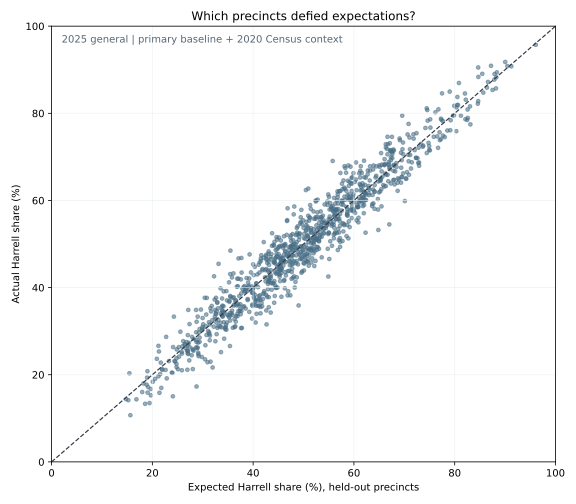

# Beyond the Election Map

*What Seattle's 2025 mayoral election reveals about neighborhood contrasts—and the places where the familiar patterns tell only part of the story.*

**Exploratory research article · Seattle · November 2026**

> **The central finding:** Seattle's November electoral geography was highly predictable from its August primary. But some precincts that looked similar in both their earlier voting history and selected Census characteristics ended up far apart in November. The differences are worth investigating—not automatically evidence of why voters made their choices.

## More than a map of who won

Katie Wilson received **138,931 votes** to Bruce Harrell's **136,920** in Seattle's certified 2025 mayoral general election, a margin of **2,011 votes** between the finalists.

The broad geography has been described elsewhere: Seattle is politically varied, and its neighborhoods differ in housing, density, and income. Another map of who won each precinct would add relatively little. Instead, this project asks two narrower questions:

1. How much of the November precinct result could already be anticipated using the August primary and basic Census context?
2. Where did precincts with similar political histories diverge—and are those contrasts more interesting than Seattle's already-familiar neighborhood divides?

The analysis draws on King County election returns, archived voting-district boundaries, geographically allocated 2020 Census variables, and reproducible Python code. All figures describe precinct-level aggregates, not individual voter behavior.

## 1. November was predictable, but not predetermined

To avoid fitting the same data we evaluate, we built predictions for **1,006 precincts** using five-fold, geographically grouped cross-validation. Error is measured in **percentage points** of Harrell's November two-candidate share and weighted by the number of November votes for the finalists.

| Prediction method | Vote-weighted mean absolute error |
|---|---:|
| Use August's Harrell/Wilson finalist share directly, without adjustment | 5.32 pp |
| Model August's voting patterns | 3.39 pp |
| Model August plus 2020 Census context | **3.01 pp** |

The augmented model improved prediction error by about **11% relative to the fitted primary-only model**. Its additional variables were population density, the voting-age share of residents, and the share of housing units that were occupied. Importantly, **housing occupancy is not homeownership or renter share**.

That accuracy suggests much of the political geography visible in November was already present in August. It does not tell us whether particular voters changed their minds or why the remaining differences emerged.

The second figure maps **prediction errors**, not election winners. Warm colors mean Harrell received a larger November share than expected; cool colors mean Wilson did better than the model expected.

There was **weak but statistically detectable citywide spatial association** in these errors (global Moran-style I = 0.100; permutation p = 0.0001). However, **no individual local clusters survived correction for testing 1,006 precincts**. That is why we do *not* label any particular neighborhood a statistically confirmed surprise cluster.

## 2. Historical precinct twins: similar beginnings, different Novembers

We then reversed the usual approach to finding an interesting map. Rather than searching for precincts that voted differently, we first searched for **precincts with comparable pre-November profiles**.

For this stricter analysis, pairs had to have similar Harrell shares in the **2021 mayoral election**, similar Harrell-versus-Wilson finalist shares in the **August 2025 primary**, and reasonably close values for the three 2020 Census measures described above. We kept precincts whose boundaries were stable across the historical comparison, applied minimum vote thresholds, and required geographic separation.

Among **846 eligible precincts**, **1,775 candidate pairs** passed the historical and demographic similarity criteria. We examined the most divergent November outcomes among them. This makes them **selected case studies, not independent statistical tests**.

| Compared precincts | 2021 gap | August 2025 gap | November 2025 gap |
|---|---:|---:|---:|
| Highland Park (1246) / West Seattle Junction–Genesee Hill (1464) | 0.8 pp | 4.8 pp | **17.4 pp** |
| West Seattle Junction–Genesee Hill (1449) / Queen Anne (1754) | 2.1 pp | 1.7 pp | **20.2 pp** |
| South Beacon Hill–New Holly (1639) / Ravenna–Bryant (2252) | 0.4 pp | 3.8 pp | **19.2 pp** |

### A particularly interesting contrast within West Seattle

Highland Park's precinct **1246** and Junction–Genesee Hill's precinct **1464** gave Harrell almost the same share in 2021: **61.1% versus 61.9%** of the two-candidate vote. Their August 2025 finalist shares were also within **4.8 percentage points**.

In November, though, Harrell received **46.6%** in Highland Park and **63.9%** in Junction–Genesee Hill. That is a **17.4-point gap**, between neighborhoods within the same part of the city.

Turnout offers a reason to investigate more closely: November turnout was **62.4%** in Highland Park and **76.6%** in Junction–Genesee Hill. But these rates alone do **not** explain the candidate-share differences. We cannot tell from precinct totals whether the shift reflects changes in who voted, how they voted, or other factors.

The cross-city pairs are also striking, particularly the South Beacon Hill–Ravenna comparison. Their 2021 Harrell shares were almost identical (roughly **63%**), while their November 2025 shares were **48.6% and 67.9%**. They are not otherwise equivalent neighborhoods; that is precisely why more complete housing and socioeconomic measures would be the appropriate next research step.

## 3. A political boundary you can see on the map

A separate spatial approach measured differences between precincts that physically touch. Two adjoining Queen Anne precincts, **1709 and 1724**, gave Harrell **23.8% and 81.4%** of their November two-candidate votes, respectively. They share approximately **1,283 feet** of boundary.

This is visually striking, but a Seattle resident may already expect different voting patterns across contrasting housing and neighborhood environments. The map's value is showing exactly *where* the difference appears—not pretending that a sharp boundary is automatically an unexplained political mystery.

## What we can reasonably conclude

Three findings stand out:

- **Earlier voting was highly informative.** Using the August primary plus basic Census context produced relatively small held-out prediction errors.
- **Pre-November similarity did not guarantee similar November outcomes.** The historical twins provide concrete, local examples, especially within West Seattle.
- **Visual patterns require statistical restraint.** Prediction errors were weakly correlated across the city, but no individual neighborhood cluster survived our multiple-testing correction.

These are observations, not a theory of campaign effectiveness or individual voter movement. The 2021 contest featured a different opponent (Lorena González); August 2025 shares here compare only votes cast for Harrell and Wilson, not all primary candidates. The Census data describe residents rather than voters, and our current features do not include renter share, income, educational attainment, or other potentially important neighborhood differences.

**The most useful next research question:** Does the West Seattle historical-twin contrast remain surprising after introducing better housing-tenure and neighborhood information? That would be a more meaningful addition than making another generic election map.

## Methods and sources

All analysis code is in this repository. Historical precinct matching, geometry checks, and vote reconciliation are documented separately as [methodological work](../docs/methodology/precinct_matching.md), not presented as election findings.

- [King County election results](https://kingcounty.gov/en/dept/elections/results)
- [King County precinct and district geography](https://kingcounty.gov/en/dept/elections/maps/precinct-and-district-data)
- [August 2025 primary precinct results](https://data.kingcounty.gov/d/tsx2-ia8a)
- [November 2025 general precinct results](https://data.kingcounty.gov/d/rkie-6y8x)
- [Prediction model exploration](03_precinct_surprises_exploration.md)
- [Historical precinct matching exploration](06_historical_precinct_twins.md)

The analysis and its figures are reproducible from the repository scripts using the data sources above. The static figures embedded here are generated outputs; they must be added to GitHub alongside this article for the online version to render correctly.

*Working research draft. Interpretations and visual selections are subject to further editorial review.*
