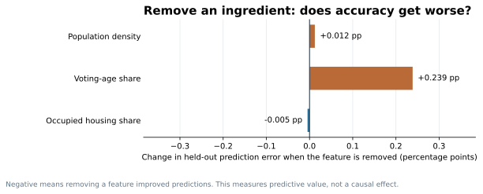

# Seattle's 2025 election, under the microscope
*What happens when we give Python a city's election results and ask it to find what a normal map misses?*

**SEATTLE ELECTION RESEARCH · NOVEMBER 2026 · SECOND-EDITION DRAFT**

Katie Wilson defeated Bruce Harrell in Seattle's 2025 mayoral general election, **138,931 votes to 136,920**. A winner map tells us where each candidate was stronger. But it can't tell us which results were **predictable**, which places behaved **unusually**, or why **apparently similar neighborhoods separated**.

I tried four computational tricks to investigate: predict the election from August, examine the biggest misses, match similar precincts, and measure divides across shared borders. Each one asks a different question. The code is part of the story, not an afterthought.

## First, can we guess November using August?

Imagine an election precinct where Harrell received **55% of the votes cast for Harrell or Wilson** in the August primary. The simplest guess is that he would receive **55% again** in November. That's our first benchmark.

A better trick is to **learn how August voting translated into November voting elsewhere in Seattle**. We trained a model on some precincts' August and November results, then asked it to estimate November in **different precincts whose results it hadn't seen**. We repeated that with five geographically separated test groups. This is a *retrospective* experiment using completed election results, **not** a prediction made before Election Day.

**Python technique: Ridge regression + geographic cross-validation (scikit-learn).** Ridge regression learns a relationship between input numbers and a result, while discouraging wildly large coefficients. Geographic cross-validation acts like a closed-book exam: the model must estimate results in areas held out from its training set. We then tried adding three Census clues—population density, voting-age population share, and how many housing units were occupied.

**How to read this:** The bars show the average size of the prediction mistake, **not candidate support**. If we predicted 60% Harrell but the result was 57%, that is a **3-percentage-point miss**. Smaller bars are better. We gave more weight to precincts with more votes for the finalists.

The simple “repeat August” method missed by **5.32 percentage points** on average. A model that learned the August-to-November relationship elsewhere in Seattle reduced that to **3.39 points**. Adding basic Census information reduced it further to **3.01 points** across **1,006 precincts**.

**Takeaway:** November wasn't random. August voting did much of the predictive work; neighborhood context added a modest additional improvement. But the model still missed some places.

### A little experiment: Which Census clues actually helped?

Here's an extra machine-learning trick called **feature ablation**. Fit the full model, remove one Census variable, then repeat the entire geographic test. If its prediction error rises, that clue was useful *in this model*. If error falls, leaving it out actually helped.

This is a quick way of checking whether a complicated-looking ingredient improves the recipe. **It doesn't prove that density, age, or housing caused a precinct to vote a particular way.** Variables can overlap in what they tell us; removing one can change how the model uses the others.

## Second, where did our estimate go wrong?

Rather than publish another ordinary expected-versus-actual scatterplot, let's identify the places where the model was most mistaken.

**How to read this:** Orange bars mean Harrell received *more* support than the model expected. Blue bars mean Wilson did better than expected (equivalently, Harrell did worse). A bar labeled **+10** means Harrell's vote share was 10 percentage points above the prediction. We show illustrative large misses among precincts with usable neighborhood labels and at least 150 finalist votes; these aren't statistically proven anomalies.

**The programming trick:** The model's **residual** is simply *actual result minus estimated result*. Compute it for every precinct, rank the misses, and attach neighborhood labels. That's more informative to a reader than a cloud of 1,006 dots.

A separate spatial check using NumPy, SciPy and Shapely asked whether neighboring errors resembled each other. The answer was **weakly yes citywide** (Moran-style I = **0.100**, permutation p = **0.0001**). But no individual precinct passed a correction for testing many local patterns. So we shouldn't announce that any particular neighborhood is a statistically established “surprise cluster.”

This leaves a more intriguing question: **Can two places look alike before November but vote very differently when it arrives?**

## Third, meet Seattle's political twins

For this question, we reversed the normal way people make election comparisons. Instead of picking two precincts because their November results were different, the code **first matched precincts using information from before November**.

**Python technique: nearest-neighbor matching (scikit-learn).** Think of a recommendation system finding two products with similar features. Here, the features were a precinct's **2021 Harrell vote share**, **August 2025 voting pattern**, and three broad **2020 Census** measures. To keep history comparable, we used precincts whose geographic boundaries hadn't materially changed. We allowed small differences, rather than demanding impossible exact matches, and excluded very low-vote precincts.

Of **846 precincts** eligible for this historical comparison, the algorithm identified **1,775 pairs** that met our similarity rules. Only *afterward* did we look for the biggest November gaps.

### A West Seattle puzzle

Two West Seattle precincts illustrate the puzzle:

- **Highland Park, precinct 1246:** Harrell received **61.1%** in 2021, then **46.6%** in November 2025.
- **Junction–Genesee Hill, precinct 1464:** Harrell received **61.9%** in 2021, then **63.9%** in November 2025.

Their Harrell-versus-Wilson primary shares in August 2025 were also within **4.8 percentage points**. In November they were **17.4 percentage points apart**.

The profile above makes the matching test visible: voting history and available Census variables on top; the November reveal below. The two precincts were *similar on measured features*, **not identical in every important way**.

The second chart expands the view to three historical-twin pairs, including a cross-city Queen Anne comparison and a South Beacon Hill–Ravenna comparison. Note that **in 2021 Harrell faced Lorena González**, while in 2025 he faced Katie Wilson; these are comparisons of historical voting geography, not the same contest repeated.

Could turnout explain West Seattle? November turnout was **62.4%** in Highland Park and **76.6%** in Junction–Genesee Hill. That's worth investigating, but the data don't reveal whether different people voted, preferences changed, or something else mattered. Our Census measures also **do not include income or the proportion of renters versus owners**. A surprising match is a lead for further research—not a causal conclusion.

## Finally, can a line on a map separate two electorates?

The twins weren't necessarily neighbors. To look at **actual neighbors**, we used geometry.

**Python technique: spatial adjacency with Shapely.** Treat each precinct like a node in a network. Connect two nodes if their geographic polygons share at least **100 feet of physical boundary**. Then calculate how different their Harrell vote shares were. This produced **2,582 neighboring-precinct comparisons** in the 2025 general election. A mere corner-touch doesn't count.

Consider two adjacent Queen Anne precincts: **1709 and 1724**. Harrell received **23.8%** of the finalist vote in one and **81.4%** in the other, a **57.6-point divide** along roughly **1,283 feet of shared border**.

It's a striking picture. Yet someone who knows Seattle might reasonably suspect different housing environments or neighborhood characteristics on either side. The code has precisely **located** the difference; it hasn't yet **explained** it.

## What I learned from putting these methods together

**Prediction** told us what was broadly expected. **Residual analysis** told us what the model missed. **Nearest-neighbor matching** found places that looked similar before the vote but ended up apart. **Spatial geometry** pinpointed sharp differences between actual neighbors. **Permutation tests** kept us from mistaking a colorful map for proof of a geographic cluster.

The most promising next research question isn't another precinct winner map. It's whether West Seattle's historical-twin contrast persists after adding reliable **housing tenure, income and local built-environment data**.

This project uses official King County election results, precinct boundaries, and geographically allocated 2020 Census measurements. Every figure is produced by Python code in this repository. The model is retrospective; this work does **not** establish individual voter switching or the cause of any electoral difference.

**Want to see how it works?** [Plain-English methods and technical appendix](../docs/methodology/techniques_explained.md) · [Data dictionary: what the files and variables mean](../data/README.md) · [Python source code](../scripts/) · [King County official election results](https://data.kingcounty.gov/d/rkie-6y8x)

*Working second-edition draft for editorial review. The published first edition remains on the repository's main branch.*
