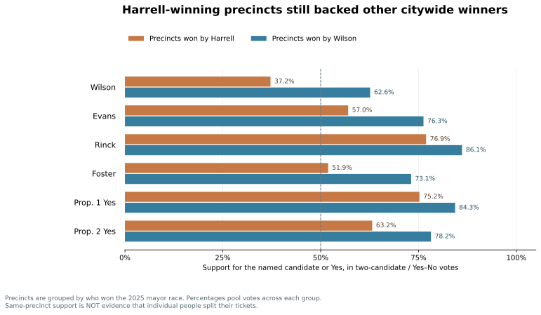

# Experiment 01 — One city, multiple political coalitions

The chart groups precincts according to their **2025 mayoral winner**, then displays the **pooled candidate/Yes vote share** in each group for six citywide contests. This tests whether the mayoral vote resembles support in other races.

**What were these contests?** Seattle voters elected a mayor, a city attorney and two citywide council members, while voting on an education property-tax levy (Proposition 1) and a business-and-occupation tax change (Proposition 2). Each table row shows **support for the named candidate or Yes**. The other candidate's support is the remainder of the two-candidate vote.

**The key observation:** Even in precincts won by Harrell, Evans, Rinck and Foster each received a majority of the votes for their respective two-candidate contests. Both propositions also received majority support.

The 50% reference line means an outright majority between the named candidates (or among Yes/No votes). This is **not individual-level split-ticket voting**: we have aggregate precinct votes, no linked ballots.

| Contest and what was decided (candidate/Yes shown) | Harrell-winning precincts | Wilson-winning precincts |
|---|---:|---:|
| Mayor — Wilson vs. incumbent Harrell; city executive (**Katie Wilson**) | 37.2% | 62.6% |
| City Attorney — Evans vs. incumbent Davison; city legal affairs (**Erika Evans**) | 57.0% | 76.3% |
| City Council Position 8 — Rinck vs. Savage; citywide council seat (**Alexis Mercedes Rinck**) | 76.9% | 86.1% |
| City Council Position 9 — Foster vs. incumbent Nelson; citywide council seat (**Dionne Foster**) | 51.9% | 73.1% |
| Proposition 1 — renew education levy for preschool, K–12 and college/career support (**Yes**) | 75.2% | 84.3% |
| Proposition 2 — change business tax: higher exemption and revised rates (**Yes**) | 63.2% | 78.2% |

**Method:** group Seattle precincts by mayoral winner; pool ballots separately for each other citywide contest. Official results from King County, November 2025.
Differential undervoting means denominators differ across races.

**Ballot descriptions:** [King County — Proposition 1: Families, Education, Preschool, and Promise Levy](https://info.kingcounty.gov/kcelections/Vote/contests/ballotmeasures.aspx?cid=101780) and [Proposition 2: Changes to the Business and Occupation Tax](https://info.kingcounty.gov/kcelections/Vote/contests/ballotmeasures.aspx?cid=101794&groupname=City&lang=en-US).
