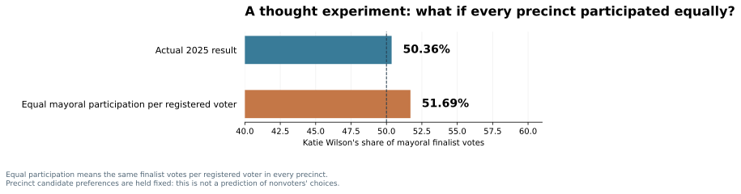

# Experiment 02 — The participation gap and Wilson's narrower observed lead

**The point:** Seattle's geography of mayoral participation mechanically reduced Wilson's winning vote share compared with a hypothetical city in which precincts contributed the same number of finalist votes per registered voter. In other words, precincts that were relatively stronger for Wilson tended to contribute fewer mayoral finalist votes per registered voter. This is a relationship between aggregates, not proof of why turnout differed.

**Actual:** Wilson received **50.36%** of the two-finalist votes. **Equal participation:** she would receive **51.69%** if every precinct contributed the same number of mayoral finalist votes **per registered voter**, holding each precinct's observed candidate split unchanged. That is a **1.33-percentage-point increase** in Wilson's share, which would widen her share advantage over Harrell. It suggests that where voters participated mattered to the closeness of the result, under these fixed-preference assumptions.

This is a **reweighting of precinct vote shares**, not a forecast of what nonvoters would have chosen, and does not separate persuasion from turnout. Only valid registered-voter denominators are used, with certified mayor totals reconciled before comparison.

Examined **1,018 precincts**, totaling **505,373 registered voters**.

**When is this used?** Analysts use reweighting and standardization to compare populations on a common basis—for example, to study how age composition affects the comparison of health rates between cities. Here the common basis is registered voters per precinct, not the observed number of mayoral votes.

**How it works (a simple example):** Suppose two precincts each have 1,000 registered voters; the first votes 60% Wilson with 600 votes cast for the finalists, and the second votes 40% Wilson with 300 finalist votes. The observed pooled Wilson share is 53.3%; equally weighting the two precincts by their registered-voter totals gives 50%. This is illustrative, not Seattle data.

**Limitation:** The counterfactual keeps the same observed support in every precinct, even though different turnout could bring out a different electorate. Registered voters are not identical to all eligible residents, and turnout in this calculation is *votes for the two finalists per registered voter*, not necessarily ballot-return turnout.

The reweighting is equivalent to taking the registered-voter-weighted average of Wilson's share in each precinct, rather than the observed-vote-weighted average.
