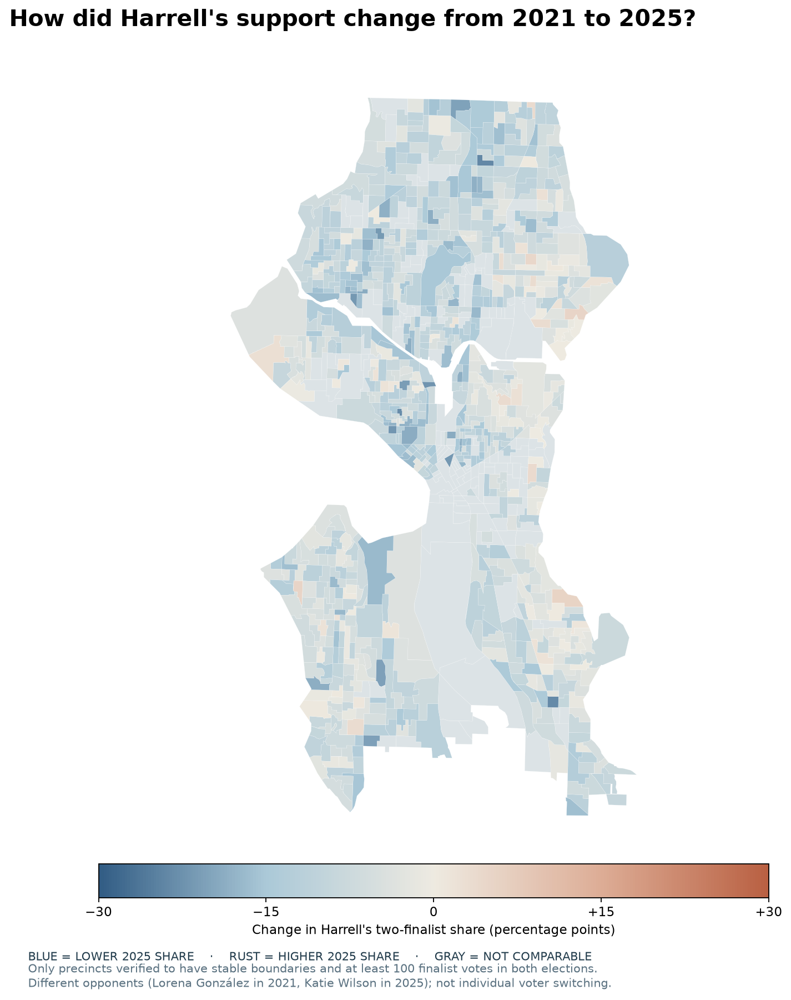
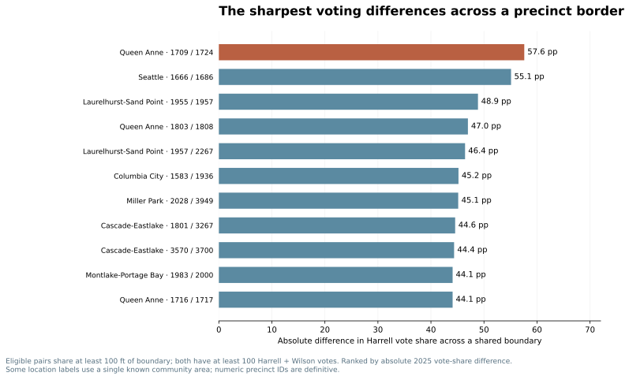
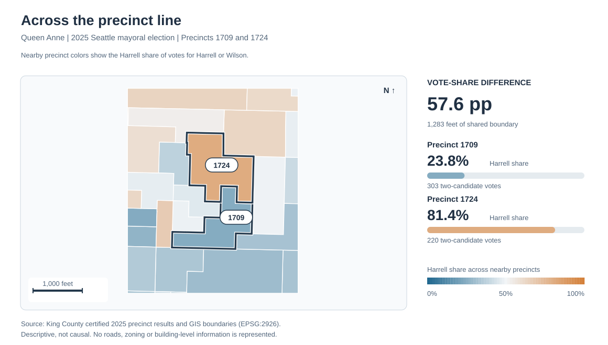

# Seattle, Precinct by Precinct
### How the city's voting map was made—and what it shows about the 2025 mayoral election

*Independent visual research · November 2026 · First editorial draft*

When Seattle votes, the results appear as a patchwork of more than a thousand small geographic units: **precincts**. Where did these shapes come from? How different are they? And what happens when we use them to examine a mayoral election decided by just **2,011 votes**?

This is a beginner's guide to those units, followed by a few computational investigations. The history is short, the maps do most of the work, and each analysis explains how its result was produced.

## 1. How Seattle got its precincts

A **voting precinct** is an administrative area used to assign voters to the correct ballot and organize voting records. It isn't necessarily a neighborhood, and it isn't one of Seattle's seven geographic City Council districts.

Seattle has had wards and precincts since its early municipal period. The [Seattle Municipal Archives' 1891 ward-and-precinct map](https://archives.seattle.gov/digital-collections/index.php/Detail/objects/21782) is a reminder that today's familiar boundaries didn't exist in the same form. The [King County Archives](https://kingcounty.gov/en/dept/executive-services/data-information-services/archives/find-it-in-archives/county-government-history/elections-history) also lists a **1915** precinct map and maps from **1936, 1944, 1986–1993, and 2000**.

[View Seattle's historical 1891 ward-and-precinct map](https://archives.seattle.gov/digital-collections/index.php/Detail/objects/21782).

**Who draws the lines today?** King County Elections proposes changes, which the King County Council formally adopts. Precincts generally need to be geographically connected, respect other electoral-district boundaries, and meet voter-count limits. The state ceiling is **1,500 active registered voters**, while King County's ordinance sets a lower ceiling of **900 active voters** at the relevant boundary-adoption stage. Geography changes through redistricting, annexations, and precinct balancing; the [official 2025 GIS layer](https://www5.kingcounty.gov/sdc/?Layer=votdst_2025_area) reflects such adjustments. [Washington law](https://app.leg.wa.gov/rcw/default.aspx?cite=29A.16.040) · [King County Code](https://aqua.kingcounty.gov/council/clerk/code/04_Title_1.htm) · [King County precinct alterations](https://kingcounty.gov/en/dept/elections/maps/precinct-alterations).

The important distinction: **these boundaries were not created to describe political opinions**. They were created to administer elections. We can nevertheless use them to study geographic voting patterns.

## 2. What does a Seattle precinct look like today?

**Finding:** Seattle precincts are more similar in the size of their registered electorates than in their *physical area*.

**Method:** Join the certified 2025 election returns to King County's official 2025 precinct polygons; count registered voters and ballots and calculate polygon area in square miles.

We found **1,018** Seattle precincts with votes for the two mayoral finalists and valid registration data. The median had **469 registered voters**, while the median mapped area was just **0.060 square miles**. Their shapes and electorates still vary substantially.

| Measure | Precinct | Value |
|---|---|---:|
| Most registered voters | SEA …-2373 (Northgate-Maple Leaf) | 1,032 voters |
| Largest mapped polygon | SEA …-1928 | 3.22 sq mi* |
| Most ballots counted | SEA …-1408 (Alki-Admiral) | 567 ballots |

*Polygon area includes water and does **not** mean dry land. Ballots counted and registered voters are distinct measures. A reported precinct with more than 900 registered voters isn't automatically evidence of a legal violation: the returns and the legally relevant precinct-balancing snapshot need not be from the same date.*

One puzzle worth noticing: **4** precincts in these final-election returns reported over 900 registered voters. We'd need historical registration snapshots and boundary-adoption records to explain those exceptions individually.

## 3. How Seattle's precincts voted in 2025

**Finding:** A citywide map hides big differences *within* familiar neighborhood names.

**Method:** Color each precinct continuously by Harrell's share of votes for Harrell or Wilson. The midpoint is a 50–50 split; deeper blue means stronger Wilson support, deeper rust means stronger Harrell support. The colors do not signify political parties.

The continuous color scale matters: two precincts can support the same candidate, but one can be almost evenly divided and the other overwhelmingly favorable.

### What happens when we look inside neighborhoods?

King County's *community reporting areas* offer a familiar way to label places, though their boundaries are descriptive—not formal electoral divisions. We grouped historically comparable precincts into those areas and calculated **vote-weighted standard deviation**: a higher number means that voting shares differed more *within* the area.

The contrast is useful: **Queen Anne** had **67** included precincts, with Harrell shares ranging from **23.7%** to **81.4%**. **Capitol Hill** had **27**, ranging from **13.3%** to **34.1%**. The chart uses a weighted variability measure rather than simply rewarding whichever area happens to contain the most precincts.

**What it doesn't show:** Why voters behaved differently, or whether a neighborhood label accurately captures residents' identities. These are election returns, not an individual-voter survey.

## 4. What changed since the 2021 mayoral election?

**Finding:** Harrell's share changed across Seattle unevenly, even where the precinct boundaries themselves remained constant.

**Method:** Compare Harrell's share among the two named mayoral candidates in **2021** and **2025** only in precincts already verified to have stable geographic boundaries. Require at least 100 votes for the two finalists in each election.

There are **846** precincts in this stricter comparison. Their median change in Harrell support was **-8.0 percentage points**, and **182** crossed the 50% threshold in one direction or the other.

**An essential caution:** In 2021 Harrell faced **Lorena González**; in 2025 he faced **Katie Wilson**. This is a comparison of where *Harrell's relative two-candidate support* changed across two different contests—not evidence that particular residents switched political preferences.

The gray precincts aren't necessarily uninteresting. They were left out because we couldn't make the same geographic comparison reliably.

## 5. Where are Seattle's sharpest political boundaries?

**Finding:** Some adjacent precincts voted much more differently than a typical pair of neighbors, despite sharing a real boundary.

**Method:** Use **Shapely** to find precinct pairs with at least **100 feet** of shared border, require at least **100 votes** for the two finalists in *each* precinct, then calculate the absolute gap in Harrell's vote share. Rank all eligible pairs.

Across **2,582** eligible neighboring pairs, the **median gap** was **7.2 percentage points**. The **99th-percentile threshold** was **35.9 points**. We call the **top 1%** *sharp boundaries* for this report: a transparent descriptive rule, not a test that the voters are fundamentally different.

The largest eligible pair, **1709 and 1724**, differed by **57.6 percentage points** while sharing roughly **1,283 feet** of border.

### A close-up: Queen Anne

A contrasting pair of Queen Anne precincts illustrates why it's worth examining the exact location, the shared street boundary, and nearby precincts—not just a ranked numerical gap. A boundary can be visually dramatic without establishing its cause.

**Another kind of surprising pair:** We also matched distant precincts that looked alike in 2021 and the August 2025 primary. A [West Seattle historical-twins comparison](figures/twin_case_studies.svg) diverged by about 17.4 points in November. But searching thousands of pairs *guarantees that some extreme differences will occur*. This is an exploratory case, not proof of a statistically exceptional event.

## 6. Can computational grouping tell us more about neighborhoods?

So far, we've used familiar neighborhood reporting areas. What if we instead treated precincts as a **network**—connecting physical neighbors and giving stronger connections to those that voted more similarly?

**Louvain community detection** repeatedly moves precincts among neighboring groups to improve how strongly connected each group is internally, then aggregates groups and repeats. Its settings affect how many groups appear. The method groups existing precincts; **it does not draw new legal voting districts**.

Our earlier exploratory run produced **11** algorithmic communities. The comparison is interesting, but the right-hand map isn't a better or more authentic version of Seattle. Geography alone creates spatial groupings. The point of this experiment is to see where grouping by the *election results* differs from using familiar neighborhood labels.

I would treat this as a **short computational epilogue**, not a grand conclusion about Seattle's identity.

## A few observations

The project began with a mundane question: *What is a precinct?* By treating the answer seriously, we found a more useful way to read the 2025 election. Precincts vary in physical size and electorate, political preferences often vary within the same named neighborhood, and some shared borders are unusually sharp. Historical comparisons add another perspective—but also require explicit matching and careful interpretation.

The election data describe **where** particular voting outcomes occurred. They do not, on their own, tell us **why** residents voted as they did.

### Sources and reproducibility

- **Official results:** [King County 2025 certified precinct CSV](https://data.kingcounty.gov/d/rkie-6y8x) and [King County 2021 general precinct CSV](https://data.kingcounty.gov/d/4qrf-rjar).
- **Precinct shapes:** [King County 2025 precinct GIS layer](https://www5.kingcounty.gov/sdc/?Layer=votdst_2025_area), projected in EPSG:2926 (US survey feet). Polygon area includes water.
- **History and boundary law:** [Seattle Municipal Archives 1891 map](https://archives.seattle.gov/digital-collections/index.php/Detail/objects/21782), [King County Archives](https://kingcounty.gov/en/dept/executive-services/data-information-services/archives/find-it-in-archives/county-government-history/elections-history), [Washington precinct law](https://app.leg.wa.gov/rcw/default.aspx?cite=29A.16.040), and [King County Code](https://aqua.kingcounty.gov/council/clerk/code/04_Title_1.htm).
- **Community area labels:** Existing precinct-to-community-reporting-area crosswalk. Neighborhood variability is calculated only for verified stable-boundary precincts with at least 100 finalist votes.
- **Computational methods:** NumPy, Matplotlib, Shapely, scikit-learn and NetworkX. [See the code](../scripts/precinct_field_guide.py) and [machine-readable summary](../data/processed/precinct_field_guide_summary.json).
- **Scope:** 2025 precinct vote mapping and descriptive boundaries are citywide; the 2021 historical comparison and neighborhood variability use a smaller subset with verified cross-year geometry. Do not silently compare those denominators.

*First draft for editorial review. The earlier eight-experiment paper is [archived here](seattle_through_the_numbers.md); the report on the published main branch remains unchanged until this revision is approved.*
