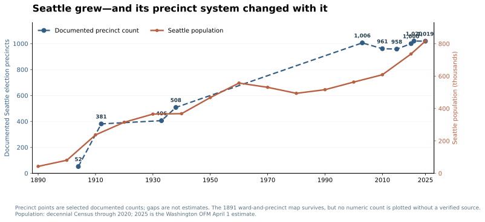
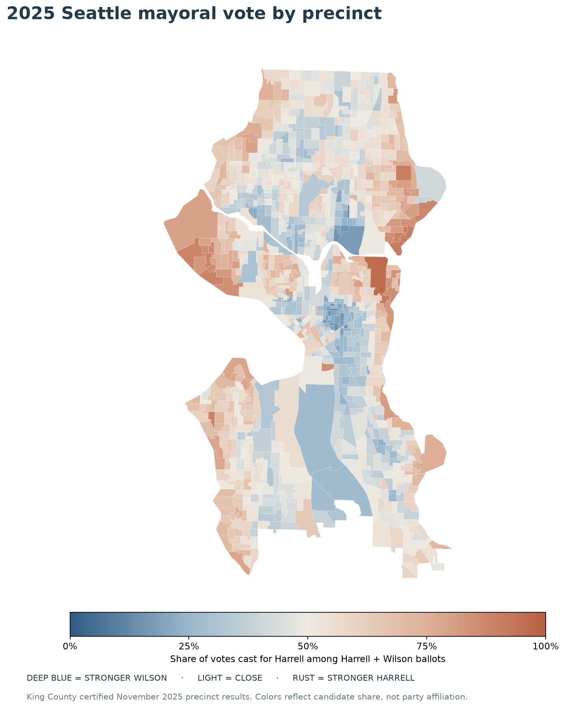
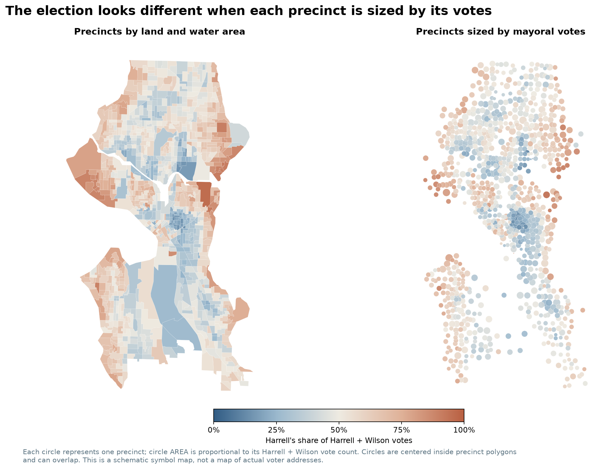
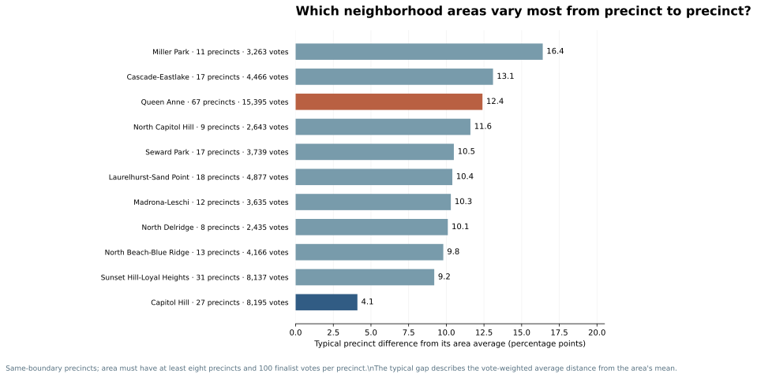
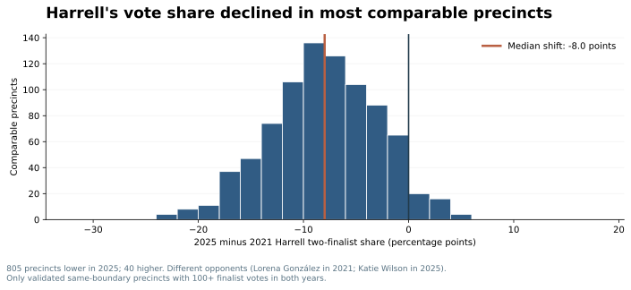

# Seattle, Precinct by Precinct
*An introduction to the city's voting geography, using the 2025 mayoral election*

Seattle's mayoral election was decided by 2,011 votes in November 2025. Those votes came from more than a thousand precincts. Before looking at who won where, it's worth knowing what a precinct is, where its boundaries come from, and how much one precinct can differ from the next.

## 1. How did Seattle get its precincts?

A precinct is a small election-administration area. It determines which ballot a voter receives and gives election officials a way to organize the results. It is not a neighborhood or a City Council district.

Seattle has used wards and precincts since its early years. The [1891 ward-and-precinct map](https://commons.wikimedia.org/wiki/File:Seattle_ward_and_precinct_map,_1891.jpg) shows a very different city.

*Seattle ward and precinct map, 1891. Seattle Municipal Archives.*

Today King County Elections proposes precinct-boundary revisions, which the County Council adopts. Boundaries must fit other electoral districts, and officials periodically adjust them as the population and registration change. King County's limit is generally 900 active registered voters per precinct at the time of boundary balancing; the state ceiling is 1,500. The election-day registered-voter total can differ from the earlier balancing count. [County precinct alterations](https://kingcounty.gov/en/dept/elections/maps/precinct-alterations) · [Washington law](https://app.leg.wa.gov/rcw/default.aspx?cite=29A.16.040).

### Has the number of precincts increased?

The archived GIS snapshots show **961 precincts in 2010** and **1,019 in 2025**—a net change of **+58**. Counts have increased over that period overall, but the chart is not a measure of Seattle's population growth. Redistricting, administrative changes and precinct splitting or consolidation can move the count in either direction.

The snapshots use the county's year-specific **voting-district maps**; they are not necessarily the same boundaries as the precincts reporting in a given election. [Archived GIS data](https://kingcounty.gov/en/dept/elections/maps/precinct-and-district-data).

## 2. What does a precinct look like today?

The official results list **1,019** Seattle precincts in 2025. Of these, **1,018** had votes for one of the two mayoral finalists and usable registration data. The median precinct had **469 registered voters** and covered **0.060 square miles**.

Most precincts are quite small geographically, but the large outliers matter. The last size bar groups precincts larger than 0.4 square miles instead of squeezing the rest of the distribution into a logarithmic scale. The mapped boundaries can include water, so polygon area is not necessarily dry land.

| By which measure? | Precinct and approximate location | Figure |
|---|---|---:|
| Most registered voters | SEA 46-2373 · Northgate-Maple Leaf | 1,032 voters |
| Largest geographic polygon | SEA 34-1928 · near Beacon Hill (approx.) | 3.22 sq mi |
| Most ballots counted | SEA 34-1408 · Alki-Admiral | 567 ballots |

The numbers describe different things. A large precinct on a map does not necessarily contain many voters, and a precinct with many registered voters may have relatively few ballots cast.

## 3. How did Seattle's precincts vote in 2025?

Each precinct is colored by Harrell's share of votes for Harrell and Wilson. Blue means Wilson led, rust means Harrell led, and lighter shades indicate closer results. **These are candidate colors, not party colors.**

In our comparable-precinct sample, **Madison Park, Laurelhurst-Sand Point, Magnolia** were among the neighborhood reporting areas with the highest Harrell shares. **Capitol Hill, North Beacon Hill-Jefferson Park, Central Area-Squire Park** were among the areas with the lowest. Those broad descriptions can still conceal substantial variation from one precinct to another.

### What if each precinct occupied space according to its votes?

On the left, a precinct's visual size is its geographic area. On the right, each precinct is a circle whose **area is proportional to votes for Harrell or Wilson**. Circles are placed near their precincts, so they can overlap. This is a schematic vote-weighted map—not the location of individual voters.

The comparison is a useful reminder: large swaths of color can dominate a geographic map without representing a correspondingly large number of votes.

### How similar are precincts within the same neighborhood?

We grouped precincts using existing community reporting areas. For each area, we calculated its vote-weighted Harrell share, then measured **how far its typical precinct was from that average**. A higher bar means more variation *within* the named area, not stronger support for either candidate.

For example, Queen Anne contributes **67 precincts** and **15,395 finalist votes** to the comparison. Its typical precinct differed from the Queen Anne average by **12.4 points**. For Capitol Hill, the comparable figure is **4.1 points** across **27 precincts** and **8,195 votes**. We show precinct counts and votes beside the labels so that these differences have some context.

These are descriptive community reporting areas, not the city's formal neighborhood boundaries. For consistency, this chart uses the subset with verified boundaries across 2021 and 2025, with at least 100 votes in each included 2025 precinct.

## 4. How did the geography change since 2021?

Harrell received a smaller share of the two-finalist vote in **805 of 846 comparable precincts**. The typical change, measured by the median across precincts, was **-8.0 percentage points**. That decline was far from identical across the city.

The histogram shows how widely the changes were distributed. **182** matched precincts crossed the 50% threshold between the two elections.

The comparison has an important limit: Harrell faced **Lorena González in 2021** and **Katie Wilson in 2025**. We can compare where his *relative support* was higher or lower; we cannot use these precinct totals to determine whether individual people changed their votes. Gray map areas weren't verified as geographically comparable, or lacked enough votes for this analysis.

## 5. Where were the sharpest precinct boundaries?

Two precincts might share a street and still vote quite differently. To find those contrasts, we used **Shapely**, a Python library that works with geographic shapes. It can identify where two precinct polygons share a line and measure that line's length.

We compared every pair of precincts sharing at least **100 feet of border**, provided each cast **100 or more votes** for Harrell or Wilson. We measured the difference between their Harrell vote shares and ranked the gaps.

Among **2,582** qualifying pairs, the median vote-share difference was **7.2 points**. At the **99th percentile**, the gap reached **35.9 points**. Here, *sharp boundary* simply means the highest 1% by that measure; it is a descriptive cutoff, not a claim about what caused the difference.

### Three nearby contrasts

These three close-ups show adjacent precincts from the ranked analysis. Expand each for a map with surrounding precincts.

<strong>Queen Anne — precincts 1709 / 1724</strong> · 57.6-point gap

<strong>Precincts 1955 / 1957</strong> · 48.9-point gap

<strong>Precincts 1803 / 1808</strong> · 47.0-point gap

The maps reveal where the difference appears, not why. We would need more information about the buildings, residents and streets on either side before claiming an explanation. The cases were chosen precisely because their differences were large.

## 6. What do computational groupings tell us about neighborhoods?

For a final comparison, we can ignore familiar neighborhood names and group precincts using **Louvain community detection**. First, connect precincts that share a border. Next, make connections stronger when neighboring precincts gave similar results across six 2025 citywide contests. Louvain then searches for groups with relatively strong connections within them.

This produced **11 groups**. The labels below are only geographic descriptions based on the most represented community reporting areas in each group. They're **not official neighborhood or election-district names**.

| Computed group (informal area labels) | Precincts | Finalist votes | Harrell | Wilson |
|---|---:|---:|---:|---:|
| Group 7: Magnolia / Interbay | 42 | 10,922 | 67.6% | 32.4% |
| Group 11: Ravenna-Bryant / Laurelhurst-Sand Point | 70 | 19,504 | 65.2% | 34.8% |
| Group 6: West Seattle Junction-Genesee Hill / Alki-Admiral | 63 | 16,001 | 58.6% | 41.4% |
| Group 8: Queen Anne / Cascade-Eastlake | 114 | 27,787 | 52.9% | 47.1% |
| Group 1: Fauntleroy-Seaview / Roxhill-Westwood | 92 | 23,874 | 52.8% | 47.2% |
| Group 5: Northgate-Maple Leaf / Olympic Hills-Victory Heights | 143 | 39,122 | 50.9% | 49.1% |
| Group 4: Greenwood-Phinney Ridge / Sunset Hill-Loyal Heights | 137 | 41,076 | 47.0% | 53.0% |
| Group 10: Central Area-Squire Park / Madrona-Leschi | 103 | 31,094 | 46.9% | 53.1% |
| Group 2: Columbia City / Rainier Beach | 127 | 33,919 | 45.0% | 55.0% |
| Group 3: Wallingford / Fremont | 70 | 18,595 | 39.2% | 60.8% |
| Group 9: Capitol Hill / North Capitol Hill | 45 | 13,351 | 27.3% | 72.7% |

The table runs from the most Harrell-supporting computed group to the most Wilson-supporting. It makes the map's color-coded clusters easier to interpret: not just where the groups are, but how many precincts and votes each contains.

One caution matters. Geography alone also produces clusters. In a separate comparison with a geography-only network, adding voting patterns changed the grouping relationship for only about **6.8% of shared precinct borders**. The algorithm gives us another perspective on Seattle's political geography, not a replacement for neighborhood boundaries.

## Sources and notes

- [King County certified 2025 general precinct results](https://data.kingcounty.gov/d/rkie-6y8x), [2021 general precinct results](https://data.kingcounty.gov/d/4qrf-rjar).
- [King County historical and current voting-district GIS data](https://kingcounty.gov/en/dept/elections/maps/precinct-and-district-data) and [election archives](https://kingcounty.gov/en/dept/executive-services/data-information-services/archives/find-it-in-archives/county-government-history/elections-history).
- The 2025 citywide maps cover precincts with valid mayoral candidate votes. The 2021 comparison and within-neighborhood chart use a smaller, previously verified stable-boundary subset. **Do not treat those as the same denominator.**
- Polygon area includes water. The vote-weighted circles are visualization symbols, not actual voter locations. The computed groups are exploratory.
- [Reproduce the figures](../scripts/precinct_field_guide.py) · [Additional figure code](../scripts/precinct_field_guide_extensions.py) · [Aggregate research data](../data/processed/precinct_field_guide_extensions.json).

*Second editorial draft. The earlier [eight-experiment report](seattle_through_the_numbers.md) remains in the research archive.*
