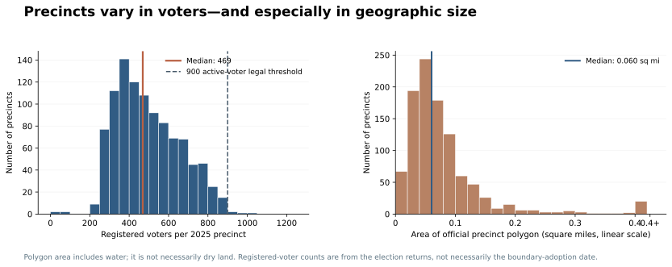
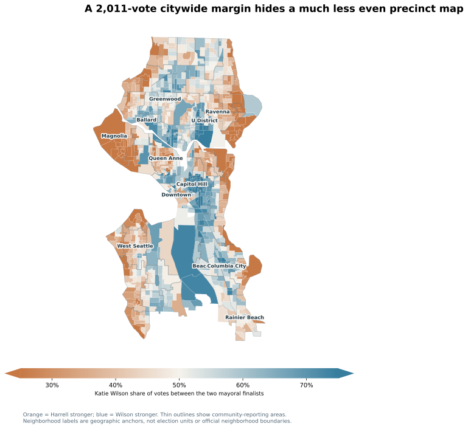
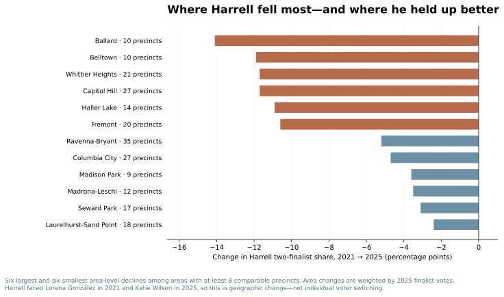
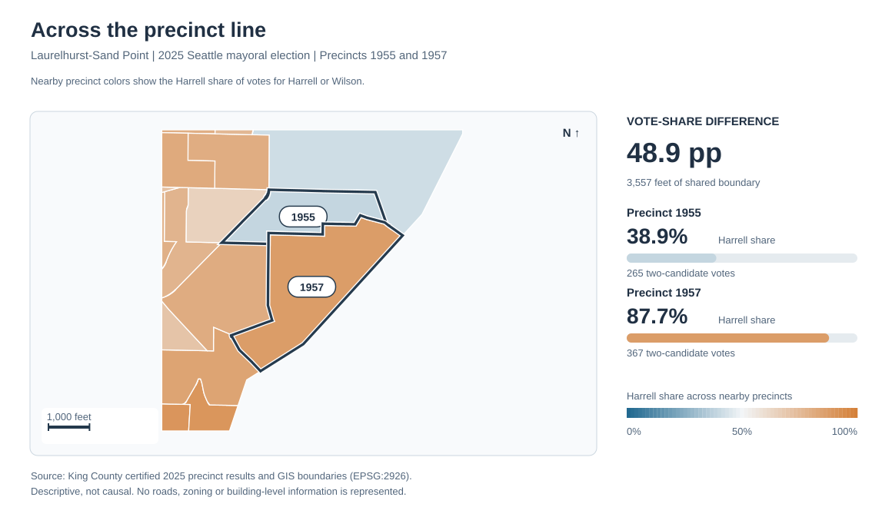
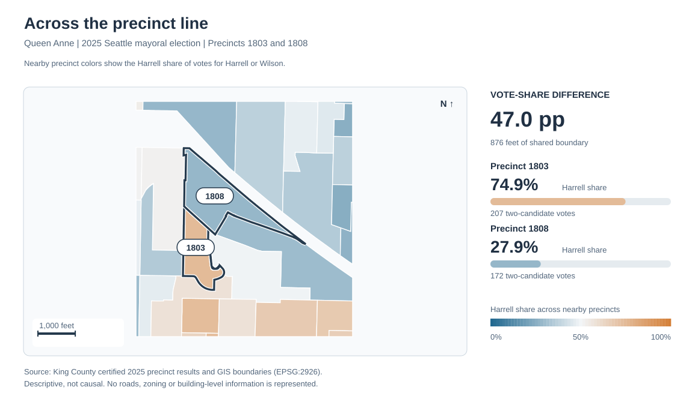
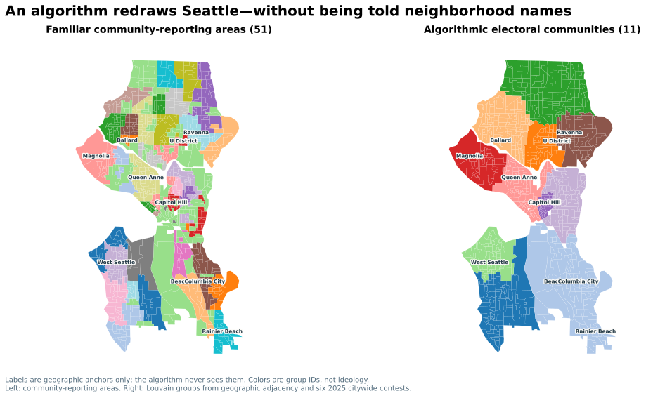
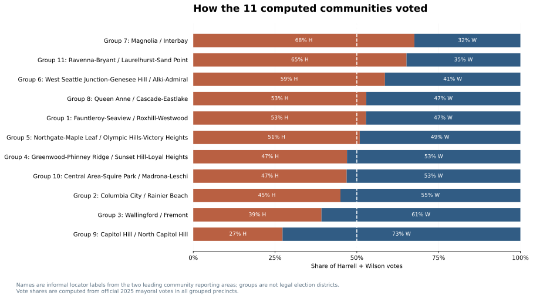

# Seattle, Precinct by Precinct
*An introduction to the city's voting geography, using the 2025 mayoral election*

Seattle's mayoral election was decided by 2,011 votes in November 2025. Those votes came from more than a thousand precincts. Before looking at who won where, it's worth knowing what a precinct is, where its boundaries come from, and how much one precinct can differ from the next.

## 1. How did Seattle get its precincts?

A precinct is a small election-administration area. It determines which ballot a voter receives and gives election officials a way to organize the results. It is not a neighborhood or a City Council district.

Seattle has used wards and precincts since its early years. The [1891 ward-and-precinct map](https://commons.wikimedia.org/wiki/File:Seattle_ward_and_precinct_map,_1891.jpg) shows a very different city.

*Seattle ward and precinct map, 1891. Seattle Municipal Archives.*

Today King County Elections proposes precinct-boundary revisions, which the County Council adopts. Boundaries must fit other electoral districts, and officials periodically adjust them as the population and registration change. King County's limit is generally 900 active registered voters per precinct at the time of boundary balancing; the state ceiling is 1,500. The election-day registered-voter total can differ from the earlier balancing count. [County precinct alterations](https://kingcounty.gov/en/dept/elections/maps/precinct-alterations) · [Washington law](https://app.leg.wa.gov/rcw/default.aspx?cite=29A.16.040).

### Has the number of precincts increased?

The longer record is much more dramatic than the 2010–2025 slice. The earliest numeric count I could verify in digitized sources is **52 Seattle precincts in 1904**. A 1912 redistricting produced **381 precincts**; contemporary election reporting listed **406 in 1933** and **508 in 1938**. By the 2003 city election there were **1,006**. Modern King County GIS snapshots show **961 in 2010**, **958 in 2015**, **1,000 in 2020**, **1,020 in 2021**, and **1,019 in 2025**.

The rust line adds Seattle's population: **42,800 people in 1890**, **237,194 in 1910**, **608,660 in 2010**, and an estimated **816,600 in 2025**. The early jump in precincts is not simply population growth. Seattle also annexed large areas in the early twentieth century and repeatedly redrew its election geography.

The **1891 ward-and-precinct map** above is older than the first numeric point on the chart. I have not found a digitized source that gives a count I am comfortable publishing for that map, so I would rather leave 1891 blank than infer it from a difficult-to-read historical scan.

Sources for the selected historical points: [1904 election report](https://oregonnews.uoregon.edu/lccn/sn83025138/1904-03-09/ed-1/seq-1/), [1912 redistricting](https://oregonnews.uoregon.edu/lccn/sn83025138/1912-07-29/ed-1/seq-2/ocr/), [1933 election report](https://oregonnews.uoregon.edu/lccn/sn85042470/1933-08-30/ed-1/seq-1/), [1938 Japanese-American Courier](https://downloads.densho.org/ddr-densho-96/ddr-densho-96-585-mezzanine-aa1eff9543.pdf), [2003 Seattle election report](https://www.seattle.gov/documents/departments/ethicselections/election%20reports/2003report.pdf), [King County election archives](https://kingcounty.gov/en/dept/executive-services/data-information-services/archives/find-it-in-archives/county-government-history/elections-history), and [Seattle population statistics](https://www.seattle.gov/city-archives/seattle-facts/quick-city-info). The 2025 population figure is the Washington Office of Financial Management estimate published by the [City of Seattle](https://www.seattle.gov/planning-and-community-development/population-and-demographics).

## 2. What does a precinct look like today?

The official results list **1,019** Seattle precincts in 2025. Of these, **1,018** had votes for one of the two mayoral finalists and usable registration data. The median precinct had **469 registered voters** and covered **0.060 square miles**.

Most precincts are quite small geographically, but the large outliers matter. The last size bar groups precincts larger than 0.4 square miles instead of squeezing the rest of the distribution into a logarithmic scale. The mapped boundaries can include water, so polygon area is not necessarily dry land.

| By which measure? | Precinct and approximate location | Figure |
|---|---|---:|
| Most registered voters | SEA 46-2373 · Northgate-Maple Leaf | 1,032 voters |
| Largest geographic polygon | SEA 34-1928 · near Beacon Hill (approx.) | 3.22 sq mi |
| Most ballots counted | SEA 34-1408 · Alki-Admiral | 567 ballots |

The numbers describe different things. A large precinct on a map does not necessarily contain many voters, and a precinct with many registered voters may have relatively few ballots cast.

## 3. How did Seattle's precincts vote in 2025?

This is the same map used on the project homepage. **Blue means Wilson was stronger; orange means Harrell was stronger; lighter precincts were closer.** The thin community-area outlines and a small set of neighborhood labels are there only to help orient the reader.

In our comparable-precinct sample, **Madison Park, Laurelhurst-Sand Point, Magnolia** were among the neighborhood reporting areas with the highest Harrell shares. **Capitol Hill, North Beacon Hill-Jefferson Park, Central Area-Squire Park** were among the areas with the lowest. Those broad descriptions can still conceal substantial variation from one precinct to another.

### How similar are precincts within the same neighborhood?

We compared each precinct's mayoral vote with the average for its community reporting area. **Shorter bars mean the precincts voted more alike; longer bars mean the area was more internally divided.** The number is the typical percentage-point difference from that area average, with larger precincts receiving more weight.

The contrast is fairly large. **Miller Park (16.4 points), Cascade–Eastlake (13.1), and Queen Anne (12.4)** were among the most internally varied qualifying areas. **Capitol Hill and Beacon Hill (both 4.1 points), and North Beacon Hill–Jefferson Park (4.5)** were among the most internally consistent. The precinct and vote counts beside each label show how much data sit behind each comparison.

These are descriptive community reporting areas, not the city's formal neighborhood boundaries. For consistency, this chart uses the subset with verified boundaries across 2021 and 2025, with at least 100 votes in each included 2025 precinct.

## 4. Where did Harrell lose the most ground since 2021?

The first-order result is obvious: Harrell's share declined almost everywhere. He received a smaller share of the two-finalist vote in **805 of 846 comparable precincts**, with a median change of **−8.0 percentage points**.

The more useful question is **where the decline was unusually large or small**.

Among community areas with at least eight comparable precincts, the largest vote-weighted declines were in **Ballard (−14.1 points), Belltown (−11.9), and Capitol Hill (−11.7)**. Harrell held up much better in **Laurelhurst–Sand Point (−2.4), Seward Park (−3.1), and Madrona–Leschi (−3.5)**.

That makes the comparison more informative than simply saying support fell citywide. Some of Harrell's strongest 2025 territory also experienced relatively small declines, while several already Wilson-leaning areas moved much further away from him.

There is still an important limit: Harrell faced **Lorena González in 2021** and **Katie Wilson in 2025**. These are changes in a place's two-finalist vote share—not evidence that the same individuals switched candidates. Only precincts with verified stable boundaries and at least 100 finalist votes in both elections are included.

## 5. Where were the sharpest precinct boundaries?

Two precincts might share a street and still vote quite differently. To find those contrasts, we used **Shapely**, a Python library that works with geographic shapes. It can identify where two precinct polygons share a line and measure that line's length.

We compared every pair of precincts sharing at least **100 feet of border**, provided each cast **100 or more votes** for Harrell or Wilson. We measured the difference between their Harrell vote shares and ranked the gaps.

Among **2,582** qualifying pairs, the median vote-share difference was **7.2 points**. At the **99th percentile**, the gap reached **35.9 points**. Here, *sharp boundary* simply means the highest 1% by that measure; it is a descriptive cutoff, not a claim about what caused the difference.

### Three nearby contrasts

These three close-ups show adjacent precincts from the ranked analysis. Expand each for a map with surrounding precincts.

<strong>Queen Anne — precincts 1709 / 1724</strong> · 57.6-point gap

The county precinct map places **1709 around Roy and Mercer at the base of Queen Anne**, while **1724 sits around Prospect and Highland higher on the hill**. That is close to a real change in urban form: the City describes Uptown around Roy/Mercer as a dense mixed-use and multifamily area, while Upper Queen Anne is a more residential environment. That makes the border a plausible place to look for a housing-and-built-form explanation—but the precinct totals alone cannot establish one. [King County precinct map](https://cdn.kingcounty.gov/-/media/king-county/depts/elections/maps/current-maps/leg-maps/leg36-2025.pdf) · [Seattle Uptown context](https://www.seattle.gov/documents/departments/sdci/about/uptowndg2019.pdf)

<strong>Laurelhurst–Sand Point — precincts 1955 / 1957</strong> · 48.9-point gap

This is probably the most locally suggestive pair. The county map places **1955 around 60th Ave NE / Radford**, immediately beside the Magnuson–Radford area, while **1957 reaches the Windermere Road side**. Seattle's Magnuson map shows a mix of park, university property, Radford Court and nonprofit housing around the former naval station; King County's assessor describes Windermere as an established, high-value residential enclave east of Sand Point Way. That sharp housing and land-use transition is a plausible clue to the 48.9-point political gap—not proof of its cause. [King County precinct map](https://cdn.kingcounty.gov/-/media/king-county/depts/elections/maps/2024/scc-maps/seattle-district-4.pdf) · [Magnuson Park map](https://seattle.gov/documents/Departments/ParksAndRecreation/Parks/Magnuson/Magnuson%20Public%202025%20-%2024x36.pdf) · [King County assessor area report](https://kingcounty.gov/en/dept/assessor/buildings-and-property/property-value-and-information/reports/area-reports/2025/residential-northwest/-/media/king-county/depts/assessor/buildings-property/reports/area-reports/2025/residential/046.pdf)

<strong>Queen Anne — precincts 1803 / 1808</strong> · 47.0-point gap

This second Queen Anne pair is farther north. **1803 is around W Bertona / W Dravus; 1808 reaches W Emerson / Nickerson near the Ship Canal.** The City describes the Nickerson corridor as an unusual seam where residences meet Seattle Pacific University, retail, freight and light-industrial uses. So again, the broad label “Queen Anne” hides a much more mixed local geography. [King County precinct map](https://cdn.kingcounty.gov/-/media/king-county/depts/elections/maps/current-maps/leg-maps/leg36-2025.pdf) · [Seattle Nickerson corridor](https://seattle.gov/transportation/projects-and-programs/programs/maintenance-and-paving/current-paving-projects/nickerson)

The maps reveal where the difference appears, not why. We would need more information about the buildings, residents and streets on either side before claiming an explanation. The cases were chosen precisely because their differences were large.

## 6. What do computational groupings tell us about neighborhoods?

For a final comparison, we can ignore familiar neighborhood names and group precincts using **Louvain community detection**, a common way to find clusters in a network. Imagine every precinct as a dot. Two dots are connected when the precincts share a substantial border, and that connection becomes stronger when they voted similarly across six 2025 citywide contests.

Louvain repeatedly tries moving precincts into neighboring groups, keeping a move when it makes the network more internally connected and more separated from the rest. In technical terms it is looking for a high-*modularity* partition. We do **not** tell the algorithm that Queen Anne, Ballard or Capitol Hill exist, and we do not tell it to produce 11 groups. Under the baseline settings, **11 is where it lands**.

This produced **11 groups**. The most Harrell-leaning group, around **Magnolia / Interbay**, gave him **67.6%** of the two-finalist vote. The most Wilson-leaning group, around **Capitol Hill / North Capitol Hill**, gave her **72.7%**. The labels below are informal geographic descriptions based on represented community reporting areas—not official district names.

| Computed group (informal area labels) | Precincts | Finalist votes | Harrell | Wilson | H − W margin |
|---|---:|---:|---:|---:|---:|
| Group 7: Magnolia / Interbay | 42 | 10,922 | 67.6% | 32.4% | +35.2 pp |
| Group 11: Ravenna-Bryant / Laurelhurst-Sand Point | 70 | 19,504 | 65.2% | 34.8% | +30.4 pp |
| Group 6: West Seattle Junction-Genesee Hill / Alki-Admiral | 63 | 16,001 | 58.6% | 41.4% | +17.2 pp |
| Group 8: Queen Anne / Cascade-Eastlake | 114 | 27,787 | 52.9% | 47.1% | +5.8 pp |
| Group 1: Fauntleroy-Seaview / Roxhill-Westwood | 92 | 23,874 | 52.8% | 47.2% | +5.6 pp |
| Group 5: Northgate-Maple Leaf / Olympic Hills-Victory Heights | 143 | 39,122 | 50.9% | 49.1% | +1.8 pp |
| Group 4: Greenwood-Phinney Ridge / Sunset Hill-Loyal Heights | 137 | 41,076 | 47.0% | 53.0% | −6.0 pp |
| Group 10: Central Area-Squire Park / Madrona-Leschi | 103 | 31,094 | 46.9% | 53.1% | −6.2 pp |
| Group 2: Columbia City / Rainier Beach | 127 | 33,919 | 45.0% | 55.0% | −10.0 pp |
| Group 3: Wallingford / Fremont | 70 | 18,595 | 39.2% | 60.8% | −21.6 pp |
| Group 9: Capitol Hill / North Capitol Hill | 45 | 13,351 | 27.3% | 72.7% | −45.4 pp |

The **H − W margin** is Harrell's percentage minus Wilson's percentage: positive values favor Harrell, negative values favor Wilson. The table runs from the most Harrell-supporting computed group to the most Wilson-supporting. It makes the map's color-coded clusters easier to interpret: not just where the groups are, but how many precincts and votes each contains.

Geography alone also produces clusters. In a separate comparison with a geography-only network, adding voting patterns changed the grouping relationship for only about **6.8% of shared precinct borders**. The algorithm gives us another perspective on Seattle's political geography, not a replacement for neighborhood boundaries.

## Explore the data

The cleaned outputs used for this field guide are published with the project. You can download the [precinct-level boundary and election file](../data/processed/precinct_field_guide_boundaries.csv), the [summary metrics](../data/processed/precinct_field_guide_summary.json), and the [extended analysis outputs](../data/processed/precinct_field_guide_extensions.json) to test your own questions or reproduce the figures.

The files are aggregated election data, not individual voter records. The 2025 citywide analysis and the smaller 2021–2025 matched-precinct analysis use different denominators; the notes below flag that distinction.

## Sources and notes

- [King County certified 2025 general precinct results](https://data.kingcounty.gov/d/rkie-6y8x), [2021 general precinct results](https://data.kingcounty.gov/d/4qrf-rjar).
- [King County historical and current voting-district GIS data](https://kingcounty.gov/en/dept/elections/maps/precinct-and-district-data) and [election archives](https://kingcounty.gov/en/dept/executive-services/data-information-services/archives/find-it-in-archives/county-government-history/elections-history).
- The 2025 citywide maps cover precincts with valid mayoral candidate votes. The 2021 comparison and within-neighborhood chart use a smaller, previously verified stable-boundary subset. **Do not treat those as the same denominator.**
- Polygon area includes water. The vote-weighted circles are visualization symbols, not actual voter locations. The computed groups are exploratory.
- [Reproduce the figures](../scripts/precinct_field_guide.py) · [Additional figure code](../scripts/precinct_field_guide_extensions.py) · [Aggregate research data](../data/processed/precinct_field_guide_extensions.json).

*The earlier [eight-experiment report](seattle_through_the_numbers.md) remains in the research archive.*
