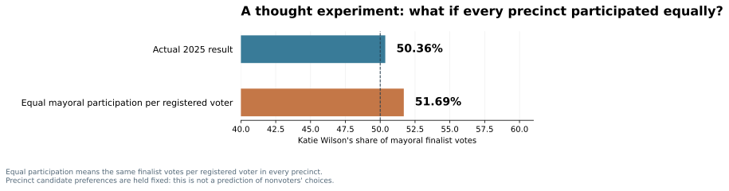

# Seattle, Through the Numbers
## Eight Computational Experiments on the 2025 Election

**Independent research · November 2026 · Working edition**

Seattle's mayoral election was decided by **2,011 votes**. But the bigger story might be what the mayoral result doesn't tell us: how the same neighborhoods voted in other contests, which districts contributed disproportionately through turnout, whether supposedly unusual results are statistically unusual, and what happens if we let an algorithm draw its own map of Seattle.

This is a **graphic-first research note**, not a list of coding exercises. Each experiment begins with a specific question, shows one primary graphic (two if unavoidable), explains the computational trick in plain English, and offers a methodological note for readers who want the technical details.

**Reading key:** **Experiments 1–2 have been calculated and verified** against King County's certified returns in GitHub Actions. Sections 3–8 are **research questions, not findings** until their data and statistical checks are complete. The completed first-edition mayoral report remains separately available [here](00_beyond_the_election_map.md).

---

## I. The election we actually held

### 01. Even Harrell's precincts voted for Seattle's other winners

*Could two precincts agree about the mayor but disagree about the rest of the ballot?*

In the certified 2025 election, the city also voted for attorney, two citywide council seats and two propositions. We divide precincts according to **who won the mayoral race there**, then ask how those same groups of precincts voted in other citywide contests.

**The striking result:** In precincts that Harrell won, **57.0%** of the two named city-attorney votes went to **Erika Evans**, while **76.9%** of the two named Council Position 8 votes went to **Alexis Mercedes Rinck**. **Dionne Foster** also narrowly led in those same precincts (**51.9%**). And both city propositions won majority Yes votes. A precinct's mayoral preference does not define a single, uniform political coalition.

**The computational trick:** Join official results across races using a shared precinct ID, then calculate the portion of two-candidate (or Yes/No) votes going to each selected candidate or option.

**How to read the figure:** An orange bar is the pooled share of votes in **Harrell-winning precincts**; a blue bar is the corresponding share in **Wilson-winning precincts**. These are precinct-level aggregates—not evidence that any particular individual split their ballot.

[Detailed table and method](experiments/01_coalitions.md)

### 02. Equal participation would have widened Wilson's mathematical advantage

*Would the citywide mayoral result look different if each registered voter contributed the same expected number of votes for a mayoral finalist, no matter the precinct?*

Wilson won **50.36%** of the votes cast for the two mayoral finalists. Under a mechanical scenario in which every precinct casts the same number of mayoral finalist votes **per registered voter**—while keeping each precinct's candidate split fixed—her share becomes **51.69%**. That's **1.33 percentage points higher**, not a forecast of the result we would have seen in a different turnout environment.

We hold each precinct's observed candidate preference fixed but reweight precincts according to their numbers of registered voters rather than their observed votes. It is a thought experiment: **not** a prediction of how nonvoters would have chosen.

**The computational trick:** A weighted average. Actual results weight precincts by ballots cast for Harrell and Wilson; the counterfactual weights them by registered voters. That isolates one *mathematical* consequence of the geographic distribution of participation, not its political cause.

[Detailed calculation and limitations](experiments/02_equal_participation.md)

---

## II. What statistics can—and cannot—tell us

### 03. Was November predictable?

*How much could we estimate from the August primary before adding demographic context, and which precincts were difficult to predict?*

Our existing model's geographically held-out mean absolute error was **3.01 percentage points** across **1,006 precincts**, using August votes plus basic Census features. The next step is to add calibrated **prediction intervals** so readers can distinguish a big raw miss from a genuinely unusual one.

**The computational trick:** Out-of-area cross-validation (scikit-learn) followed by prediction-interval calibration (MAPIE or an equivalent tested approach). An interval is not a certainty: we'd test its actual coverage on held-out geographic groups.

**Primary chart planned:** Selected predictions with confidence/uncertainty bands, highlighting exceptions that exceed those bands. No new intervals have been calculated yet.

### 04. Are Seattle's political twins actually surprising?

*If we examine thousands of similar precinct pairs, are dramatic differences inevitable?*

Previously, we found a Highland Park/Junction–Genesee Hill pair where Harrell's 2021 result differed by only **0.8 percentage points**, but his November 2025 share differed by **17.4 points**. However, we deliberately searched for the most divergent pairs among **1,775 qualifying matches**.

**The computational trick:** Keep the matching rule fixed, generate a defensible null distribution that respects precinct size and geography, and measure the chance of the **largest** observed gap—not the chance of a pre-selected pair. This prevents confusing a dramatic chart with a statistically extraordinary discovery.

**Primary chart planned:** Observed twin divergence against the distribution of maximum gaps from simulated elections.

### 05. Follow the money

*Did the geographic sources of campaign contributions resemble the places each candidate performed well?*

Washington's Public Disclosure Commission publishes contribution data. We'd compare donations to Harrell and Wilson at a privacy-respecting geographic level against local election returns. A large fundraising gap does not tell us whether donors changed votes.

**The computational trick:** Geographic joins with careful address/geographic normalization, then per-capita or per-registered-voter normalization and comparison with candidate support.

**Primary chart planned:** Paired geographic views of contribution intensity and electoral support. Data retrieval and denominator checks still pending.

### 06. Can we reconstruct a voter's choices from precinct totals?

*If a neighborhood supported Wilson for mayor and another candidate for city attorney, how many voters chose both?*

Precinct aggregates generally **do not tell us that**. Different underlying individual ballots can yield exactly the same candidate totals. This observation matters whenever people describe precinct-level results as though they reveal how a person voted.

**The computational trick:** Show two hypothetical sets of individual ballots with the same precinct totals; then explain what a specialized ecological-inference model (such as PyEI) must assume to estimate relationships.

**Primary chart planned:** A visual thought experiment illustrating non-identifiability. Any fitted ecological-inference model will be clearly labeled as assumption-dependent.

---

## III. Seattle, redrawn

### 07. Let an algorithm invent Seattle's political neighborhoods

*Would a computer draw Capitol Hill, Queen Anne, Ballard and Beacon Hill the way residents do?*

Supply a network of precincts connected by their shared boundaries. Assign stronger connections to neighboring precincts whose **multi-race electoral profiles** are more similar. Then let community detection propose geographic regions, without telling the algorithm the names of traditional neighborhoods.

**The computational trick:** Spatial adjacency (Shapely) plus graph community detection (NetworkX Louvain, potentially Leiden with a compatible environment). The algorithm finds connected groups with more internal similarity, not a universally correct political map.

**Primary chart planned:** Conventional community reporting areas next to an algorithmically generated electoral map. This is the visual finale.

### 08. Did we discover those neighborhoods—or create them?

*Would the map survive different analytical assumptions?*

Every map depends on choices: which races are included, how we balance candidate-share differences, and how many communities to permit. Simply redrawing a precinct map onto an H3 hexagon grid cannot create finer-grained election votes.

**The computational trick:** Stability and sensitivity tests. Repeat the clustering under multiple reasonable choices; quantify how consistently neighboring precincts remain in the same discovered group.

**Primary chart planned:** A map of *stable versus fragile* political boundaries, rather than a decorative alternate map.

---

## How this report will be written

Each numbered section will ultimately have a conclusion-style title **only after the finding has been computed and checked**. Aim for one strong graphic and about 150–250 words per experiment, with numbered technical notes and links to exact reproducible code.

This research uses King County's certified 2025 precinct results, 2020 Census-derived geography, and additional datasets only when they can be reliably sourced and documented. Changing precinct boundaries, unequal turnout, multiple comparisons, privacy, and the ecological fallacy require explicit treatment, not hidden assumptions.

**Sources:** [King County November 2025 final precinct CSV](https://data.kingcounty.gov/d/rkie-6y8x) · [Official final results](https://results.vote.wa.gov/results/20251104/king/) · [Previous precinct-matching methods](../docs/methodology/precinct_matching.md) · [Existing analysis code](../scripts/)

*Draft research series. No claim is made that planned analyses have been completed. The live report on the main branch is preserved until this new edition is reviewed and approved.*
