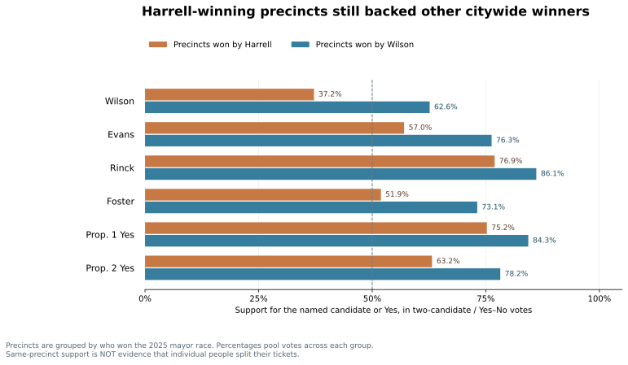
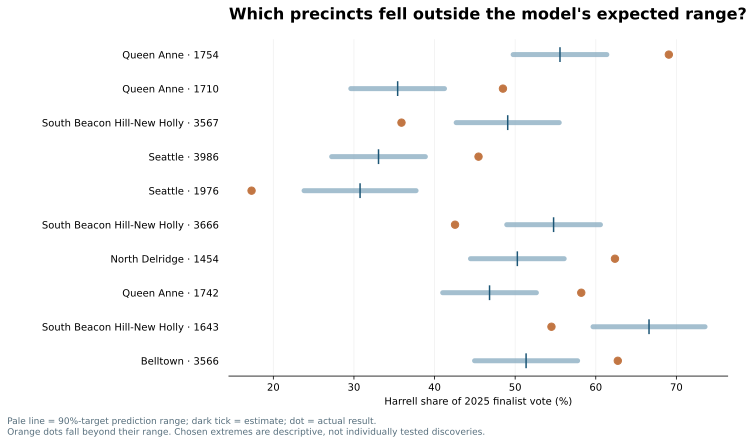
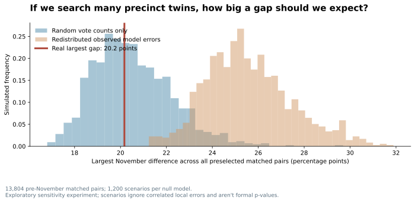
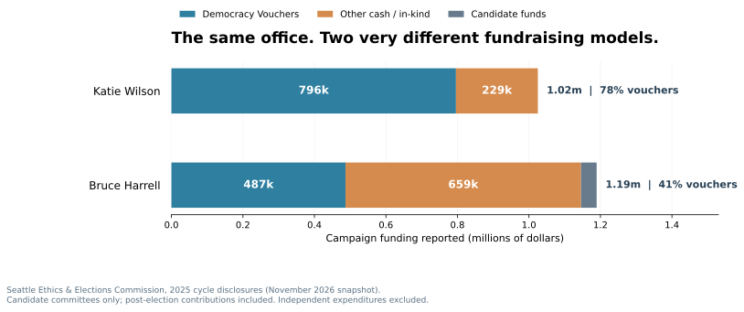
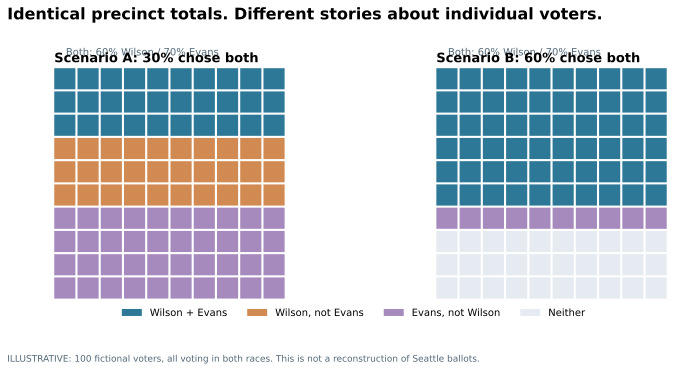
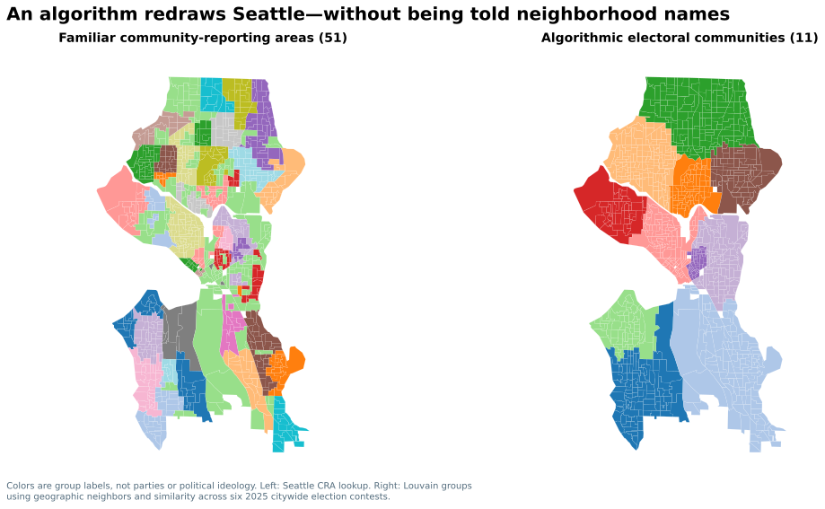

# Seattle, Through the Numbers
## Eight Computational Experiments on the 2025 Election

**Independent research · November 2026 · Research draft**

Katie Wilson defeated Bruce Harrell by **2,011 votes** in Seattle's 2025 mayoral election. But the winning margin is only the beginning. What happens when we compare different contests, remove differences in participation, model uncertainty, simulate political coincidences, follow campaign funding—and finally let a computer draw a completely new electoral map of Seattle?

Eight experiments; one main figure each. The idea isn't to make Seattle politics artificially complicated. It's to show how a handful of computational techniques can make familiar facts look different.

---

## I. The election we actually held

### 01 · Harrell's precincts still backed Seattle's other winners

**The result.** Even where Harrell won, **Erika Evans won 57%** of the city-attorney vote between the two finalists, **Alexis Mercedes Rinck won 76.9%** for Council Position 8, and **both city propositions earned majorities**. Seattle didn't divide neatly into two interchangeable voting blocs.

**The trick:** Join six contests by precinct ID, then compare each candidate's support inside the same sets of precincts. Orange means Harrell-winning *mayoral precincts*, not a Republican or party vote. This is **not** proof that individual voters split their tickets.

[What each contest decided, with the full table](experiments/01_coalitions.md)

### 02 · The turnout geography narrowed Wilson's observed advantage

**The result.** Wilson won **50.36%** of the votes for the two mayoral finalists. Holding every precinct's observed candidate preference fixed, but giving each precinct the same number of finalist votes *per registered voter*, increases her calculated share to **51.69%**—a **1.33-percentage-point difference**.

**The trick:** Reweight precincts by *registered voters*, rather than *votes cast for the finalists*. This standardization isolates one mathematical implication of **where participation was concentrated**. It's not a prediction of how abstainers would vote; a changed electorate could have changed candidate shares too.

[Calculation, simple example and limitations](experiments/02_equal_participation.md)

---

## II. What can statistics reveal?

### 03 · The model can estimate a range—not just a single number

**The result.** Our geographic train/calibrate/test experiment produced intervals targeting **90% coverage**; they contained **90.5%** of the held-out precinct results in this retrospective check. Their mean width was **12.8 percentage points**. The chart selects the largest misses *outside* those ranges.

**The trick:** Train Ridge regression on three geographic groups, calibrate the prediction-error range on a fourth, then test on a fifth; rotate the roles. The model uses August's primary vote and three broad 2020 Census variables. This is **retrospective cross-validation**, not a pre-election forecast. Geographic dependence means a nominal 90% interval is not a formal universal guarantee.

**Why it matters:** A five-point model miss can be ordinary in one test and remarkable in another. Always look at the uncertainty *before* declaring an anomaly.

### 04 · With thousands of twins, spectacular differences become easier to find

**The result.** We identified **13,804** geographically separated precinct pairs that passed a **pre-November similarity test** using 2021 voting, August 2025 voting and Census measures. The largest observed November difference was **20.2 percentage points**. Across **1,200** simulations, the typical largest gap was **20.3 points** if only independent vote-count noise occurred, or **25.4 points** when we shuffled the model's actual precinct prediction errors.

**The trick:** Don't test one extraordinary-looking pair *after selecting it*. Search the same candidate-pair pool in *every simulation*, and examine the **maximum** difference each time. The original West Seattle twins (2021 Harrell shares within 0.8 points; November gap 17.4 points) are a relatable example, not automatically a statistically significant anomaly.

**Caution:** The simulations are sensitivity scenarios, not reliable p-values. Independent binomial draws ignore neighborhood heterogeneity, and shuffled model errors discard geographic correlations. Different assumptions give different expectations.

---

## III. Money and what aggregate results hide

### 05 · Two candidates, two very different sources of campaign money

**The result.** Democracy Vouchers accounted for approximately **78%** of Wilson's reported direct campaign funding versus **41%** of Harrell's. Harrell reported substantially more other cash and in-kind contributions.

**The trick:** Compare the **composition** of money, not just the total. This chart draws on the official Seattle Ethics & Elections Commission's <a href="https://web6.seattle.gov/ethics/elections/campaigns.aspx?IDNum=965&cycle=2025&leftmenu=collapsed&type=campaign">Harrell</a> and <a href="https://web6.seattle.gov/ethics/elections/campaigns.aspx?IDNum=988&cycle=2025&leftmenu=collapsed&type=campaign">Wilson</a> committee records, as reported in November 2026.

**What's omitted:** Independent-expenditure committees and donors' geographic addresses. This is a campaign-cycle financing comparison, including some post-election reporting—not a statement about how much was spent before election day, or where individual donors voted.

### 06 · We can't tell who split their ticket by looking at precinct totals

**The result.** Imagine 100 voters, 60 for Wilson and 70 for Evans, all voting in both races. Somewhere between **30 and 60** of them could have voted for *both*. The same aggregate result can come from completely different individual behavior.

**The trick:** Construct two possible individual-level tables with identical margins. That's the *ecological inference problem*: the totals alone don't determine the cross-votes. Sophisticated statistical packages such as PyEI can model this relationship only by adding assumptions, which must be explained.

*The dots in this figure are hypothetical people—not Seattle voter records.*

---

## IV. Seattle, redrawn

### 07 · Let an algorithm invent new political neighborhoods

**The result.** Without receiving any traditional neighborhood labels, our algorithm identified **11** electoral communities across **1,006** precincts, linked by **2,582** meaningful geographic borders. Compare the right-hand map with the familiar community-reporting areas at left.

**The trick:** Represent each precinct as a node in a graph. Connect two nodes only if they share at least 100 feet of boundary; give stronger connections to neighbors with more similar results in **six** citywide 2025 ballot contests. NetworkX's **Louvain community detection** finds groups with stronger internal links. We never tell it what "Capitol Hill" or "Ballard" means.

**Interpretation:** The regions are *algorithmic clusters*, not independently verified political identities. The colors merely distinguish groups; they do not label partisan preferences.

### 08 · Are those boundaries real—or did the model draw them for us?

**The result.** Across five defensible versions of the clustering model—altering the included races and how many groups the algorithm prefers—**12.9%** of shared precinct borders changed whether their neighbors were assigned to the *same* electoral community. **1.6%** were dividing borders in every specification; **85.5%** stayed within one group every time.

**The trick:** Run the *same community-detection algorithm* repeatedly with different inputs. Instead of trusting the most attractive map, ask which geographical boundaries survive. Dark lines in the figure are consistently divisive; orange lines are sensitive to model choice.

**The lesson:** A sophisticated map can be partly a picture of its designer's assumptions. Mapping how sensitive it is may be more valuable than choosing one authoritative-looking version.

---

## Where this leaves Seattle

The methods tell different stories, and they shouldn't all be forced into a single political conclusion.

**Cross-race comparison** reveals coalitions that cannot be reduced to the mayoral contest. **Turnout reweighting** shows the geographic arithmetic behind a narrow result. **Uncertainty estimates and simulations** distinguish genuine evidence from selected extremes. **Campaign-finance data** shows a second kind of coalition. **Ecological inference** reminds us of the limits of precinct data. And **graph community detection** provides a fresh picture of the city—whose sensitivity we can examine instead of ignoring.

The key results are descriptive; none establishes how a particular voter changed their mind or why a neighborhood behaves as it does. Several results depend on choices about geographic units, candidate groupings, and statistical assumptions.

### Methods and sources

- **Official returns:** [King County's certified November 2025 precinct CSV](https://data.kingcounty.gov/d/rkie-6y8x), [August primary](https://data.kingcounty.gov/d/tsx2-ia8a), and [2021 general](https://data.kingcounty.gov/d/4qrf-rjar).
- **Political geography:** [2025 voting-district shapes](https://services.arcgis.com/Ej0PsM5Aw677QF1W/ArcGIS/rest/services/VOTDST_2025_AREA_3072/FeatureServer/0), 2020 Census geographic allocation, and King County precinct-to-community-reporting-area labels.
- **Campaign funding:** [Seattle official disclosure portal](https://web6.seattle.gov/ethics/elections/campaigns.aspx?IDNum=224&cycle=2025&leftmenu=collapsed&type=contest) (November 2026 snapshot; direct campaign committees only).
- **Computational techniques:** scikit-learn, SciPy, Shapely, NetworkX, Matplotlib, and NumPy. [Source code](../scripts/) and [prior detailed methodology](../docs/methodology/techniques_explained.md).
- **Reproduction:** the GitHub Actions workflow runs the analysis from official inputs and commits verified graphics and aggregate research outputs.

*Independent exploratory study · Working review edition · See the source code for precise parameters. This draft does not alter the published first edition.*
