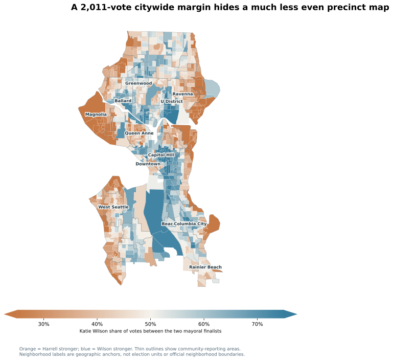
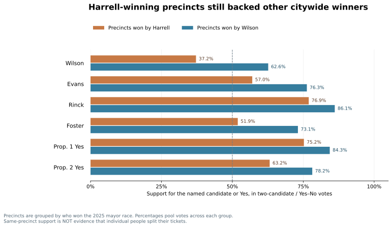
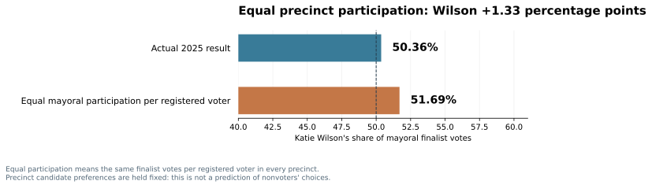
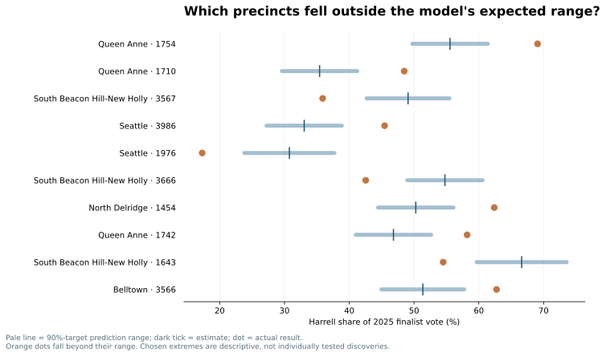
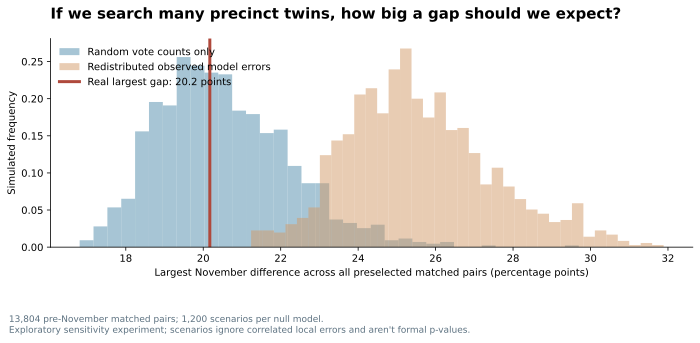
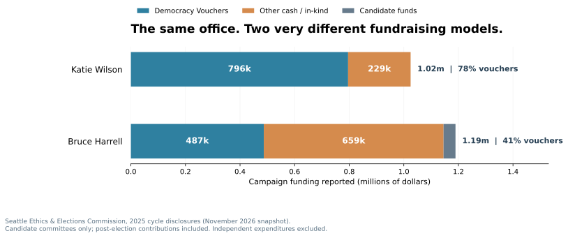
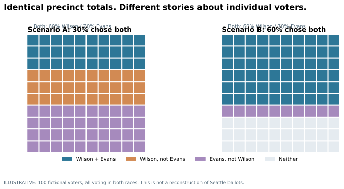
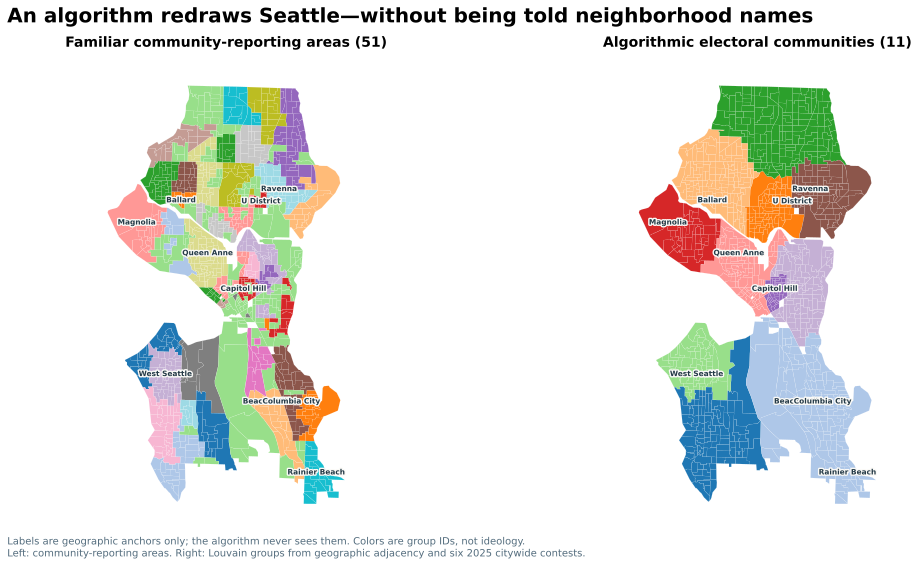
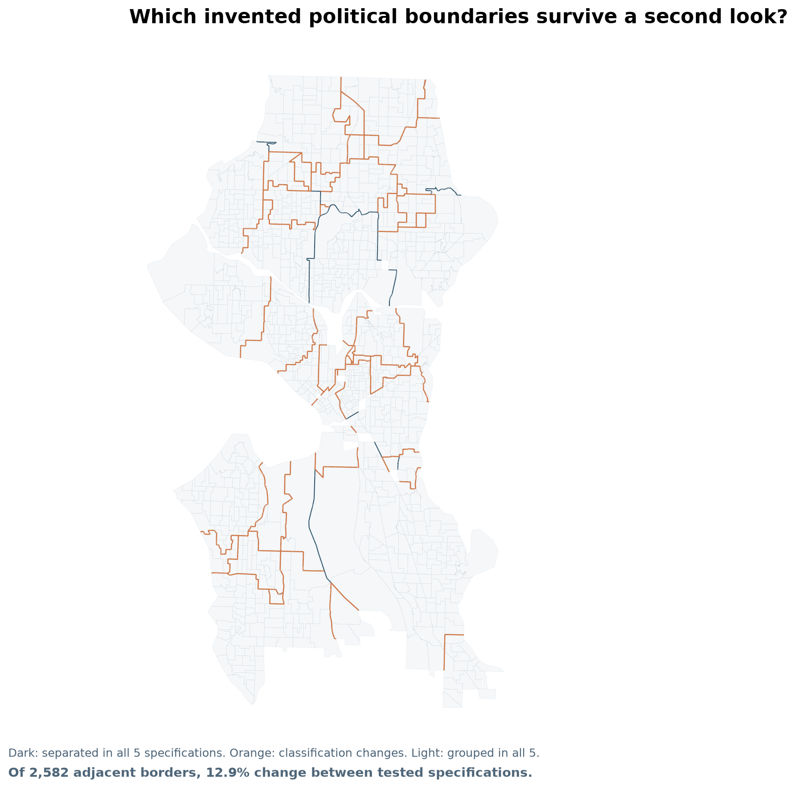

# Seattle, Through the Numbers
## Eight Computational Experiments on the 2025 Election

**Independent research by Sho Tsubakiyama · November 2026**

Katie Wilson defeated Bruce Harrell by **2,011 votes** in Seattle's 2025 mayoral election. The close finish is the obvious story. This project asks what the precinct returns can tell us beyond it: where the city divided, where participation mattered, what looked predictable, what only looked surprising, and what happens when an algorithm redraws Seattle without being told its neighborhood names.

Eight experiments, each centered on one main figure. Together they move from the election people actually voted in, to what statistical models can and cannot infer, and finally to a new electoral map of the city.

*Start with the geography.* The thin outlines are community-reporting areas derived from the King County crosswalk. The labels are orientation points, not election units or official neighborhood boundaries. The precinct colors show Katie Wilson's share of the votes between the two mayoral finalists.

Three things are worth keeping in mind before the experiments:

- **The citywide result was close, but Seattle was not geographically uniform.** A 50–50 finish can hide large precinct-to-precinct differences.
- **The mayoral map is not a complete political map.** Precincts that backed Harrell still supported several other citywide winners by clear margins.
- **Precincts describe places, not individual people.** Aggregate returns cannot identify individual split-ticket voters or tell us why a neighborhood changed.

---

## I. The election we actually held

### 01 · Harrell precincts were not a separate political city

Even where Harrell won the mayoral vote, **Erika Evans won 57%** of the city-attorney vote between the two finalists, **Alexis Mercedes Rinck won 76.9%** for Council Position 8, and **both city propositions earned majorities**. Seattle did not divide into two interchangeable voting blocs.

**How it works.** Join six contests by precinct ID, group precincts by their mayoral winner, and compare support inside the same geographic groups. Orange means Harrell-winning *mayoral precincts*, not a Republican or party vote. This is **not** evidence that particular individuals split their tickets.

[What each contest decided, with the full table](experiments/01_coalitions.md)

### 02 · Equal precinct participation would raise Wilson's share by 1.33 points

Wilson won **50.36%** of the votes for the two mayoral finalists. Holding every precinct's observed candidate preference fixed, but giving each precinct the same number of finalist votes *per registered voter*, raises her calculated share to **51.69%**—a **1.33-percentage-point difference**.

**How it works.** Reweight precincts by *registered voters* rather than *votes cast for the finalists*. The exercise isolates one mathematical implication of **where participation was concentrated**. It is not a prediction of how abstainers would have voted; a different electorate could also have produced different candidate shares.

[Calculation, simple example and limitations](experiments/02_equal_participation.md)

---

## II. What can statistics reveal?

### 03 · Prediction is more useful when it shows how wrong it can be

The geographic train/calibrate/test experiment targeted **90% coverage** and contained **90.5%** of the held-out precinct results in this retrospective check. The mean interval was still **12.8 percentage points wide**.

**How it works.** Train Ridge regression on three geographic groups, calibrate the prediction-error range on a fourth, then test on a fifth; rotate the roles. The model uses August's primary vote and three broad 2020 Census variables. This is **retrospective cross-validation**, not a pre-election forecast. Geographic dependence means a nominal 90% interval is not a universal guarantee.

The practical lesson is simple: a five-point miss may be ordinary in one precinct and notable in another. The uncertainty range matters as much as the point prediction.

### 04 · Once you search thousands of twins, a spectacular split becomes less spectacular

We identified **13,804** geographically separated precinct pairs that passed a **pre-November similarity test** using 2021 voting, August 2025 voting and Census measures. The largest observed November difference was **20.2 percentage points**.

But the maximum is exactly what we should expect to look dramatic when we search thousands of pairs. Across **1,200** simulations, the typical *largest* gap was **20.3 points** if only independent vote-count noise occurred and **25.4 points** when the model's observed precinct errors were redistributed.

**Why it matters.** The original West Seattle twins are still useful as a case study, but the simulation changes the claim. They are a lead for investigation, not automatically a statistically exceptional discovery.

**Caution.** These are sensitivity scenarios, not formal p-values. Independent binomial draws ignore neighborhood heterogeneity, while shuffled model errors discard geographic correlation.

---

## III. Money and what aggregate results hide

### 05 · Wilson and Harrell financed their campaigns in very different ways

Democracy Vouchers accounted for approximately **78%** of Wilson's reported direct campaign funding versus **41%** of Harrell's. Harrell reported substantially more other cash and in-kind contributions.

This chart compares the **composition** of direct campaign money, not just the total. It uses the Seattle Ethics & Elections Commission's <a href="https://web6.seattle.gov/ethics/elections/campaigns.aspx?IDNum=965&cycle=2025&leftmenu=collapsed&type=campaign">Harrell</a> and <a href="https://web6.seattle.gov/ethics/elections/campaigns.aspx?IDNum=988&cycle=2025&leftmenu=collapsed&type=campaign">Wilson</a> committee records as reported in November 2026.

**Scope.** Independent-expenditure committees and donors' geographic addresses are omitted. This is a campaign-cycle financing comparison, including some post-election reporting, not a claim about which money caused which votes.

### 06 · Precinct totals cannot tell us who split their ticket

Imagine 100 voters, 60 for Wilson and 70 for Evans, all voting in both races. Somewhere between **30 and 60** of them could have voted for *both*. The same aggregate result can come from completely different individual behavior.

This is the *ecological inference problem*: totals for a place do not determine the behavior of the people inside it. More sophisticated models can estimate relationships only by adding assumptions, which must be made explicit.

*The dots in this figure are hypothetical people—not Seattle voter records.*

---

## IV. Seattle, redrawn

### 07 · Let an algorithm invent new political neighborhoods

Without receiving any neighborhood labels, the baseline specification identified **11** electoral communities across **1,006** precincts linked by **2,582** substantial shared borders.

The left map uses established **community-reporting areas**. The right map shows clusters built from election results. The neighborhood labels appear on both only as geographic anchors; the algorithm never sees them. Look for broad areas of agreement rather than expecting every line to match.

**How it works.** Represent each precinct as a node in a graph. Connect two nodes only if they share at least 100 feet of boundary; give stronger connections to neighbors with more similar results in **six** citywide 2025 ballot contests. NetworkX's **Louvain community detection** then finds groups with stronger internal links.

The regions are *algorithmic clusters*, not independently verified political identities. Their colors distinguish groups; they do not encode party or ideology.

### 08 · The most interesting boundaries are the ones that survive changes in the model

Across five defensible versions of the clustering model, **12.9%** of shared precinct borders changed whether their two precincts belonged to the *same* electoral community. Only **1.6%** were dividing borders in every specification; **85.5%** stayed within one group every time.

**How it works.** Run the same community-detection approach repeatedly while changing the included races and the preferred granularity. Instead of trusting the most attractive map, ask which boundaries keep reappearing.

A sophisticated cluster map can look more authoritative than it is. The stability map makes the modeling choices visible.

---

## What these experiments tell us

Taken together, the experiments support three conclusions.

1. **Seattle's mayoral divide was real, but it was not a complete description of the city's politics.** Coalitions supporting other citywide winners crossed the mayoral boundary.
2. **Participation geography mattered to the closeness of the result, but precinct returns cannot tell us why.** Reweighting can show the arithmetic without pretending to recover nonvoters' preferences.
3. **The computational methods are strongest when they reveal uncertainty and limits.** Simulations make selected extremes less seductive, ecological inference blocks overclaiming, and stability tests keep the cluster map honest.

### Methods and sources

- **Official returns:** [King County's certified November 2025 precinct CSV](https://data.kingcounty.gov/d/rkie-6y8x), [August primary](https://data.kingcounty.gov/d/tsx2-ia8a), and [2021 general](https://data.kingcounty.gov/d/4qrf-rjar).
- **Political geography:** [2025 voting-district shapes](https://services.arcgis.com/Ej0PsM5Aw677QF1W/ArcGIS/rest/services/VOTDST_2025_AREA_3072/FeatureServer/0), 2020 Census geographic allocation, and King County precinct-to-community-reporting-area labels.
- **Campaign funding:** [Seattle official disclosure portal](https://web6.seattle.gov/ethics/elections/campaigns.aspx?IDNum=224&cycle=2025&leftmenu=collapsed&type=contest) (November 2026 snapshot; direct campaign committees only).
- **Computational techniques:** scikit-learn, SciPy, Shapely, NetworkX, Matplotlib, and NumPy. [Source code](../scripts/) and [plain-English methods guide](../docs/methodology/techniques_explained.md).
- **Reproduction:** GitHub Actions rebuild the analysis from official inputs, run the regression suite, and publish verified figures and aggregate outputs.

*Independent, nonpartisan, exploratory analysis. Precinct-level comparisons describe places, not individual voters, and do not establish why a neighborhood voted as it did.*
